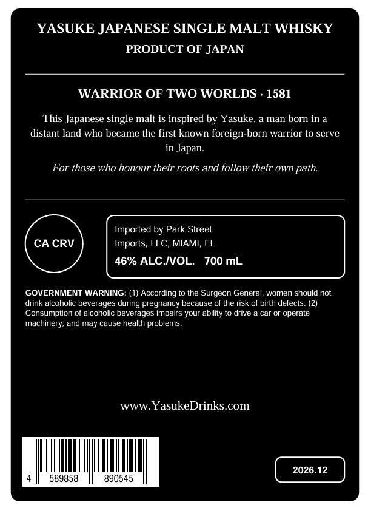
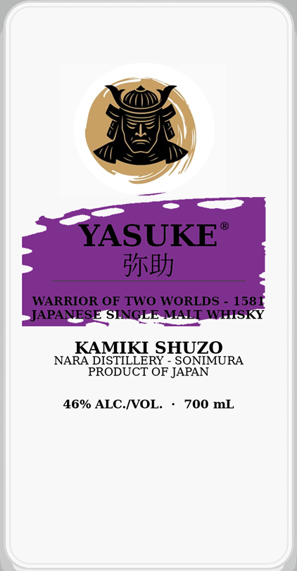

# TTB COLA Label Images - TTBID 26306001000097

**Brand Name:** YASUKE

**Issue Date:** 11/05/2026

**Origin Code:** 59

**Product Class/Type:** 118

**Source:** [TTB Public COLA Registry](https://ttbonline.gov/colasonline/viewColaDetails.do?action=publicFormDisplay&ttbid=26306001000097)

## Label Images

### Back Label

### Front Label

## Extracted Label Text

*Text extracted via OCR - may contain errors*

**Detected Proof:** 92

### Back Label

YASUKE JAPANESE SINGLE MALT WHISKY
PRODUCT OF JAPAN
WARRIOR OF TWO WORLDS
1581
This Japanese single malt is inspired by Yasuke,
man born in a
distant land who became the first known
foreign-born warrior to serve
in Japan:
For those who honour their roots and follow their own path:
Imported by Park Street
CA CRV
Imports, LLC, MIAMI; FL
46% ALC MOL.
700 mL
GOVERNMENT WARNING: (1) According to the Surgeon General; women should not
drink alcoholic beverages during pregnancy because of the risk of birth defects. (2)
Consumption of alcoholic beverages impairs your ability to drive
car or operate
machinery; and may cause health problems
WWW YasukeDrinks com
2026.12
589858
890545

### Front Label

YASUKE
HjB}
WARRIOR OF TWO WORLDS
158
JAPANESE SINGLE MALT WHISKY
KAMIKI SHUZO
NARA DISTILLERY
SONIMURA
PRODUCT OF JAPAN
46% ALC IOL
700 mL
