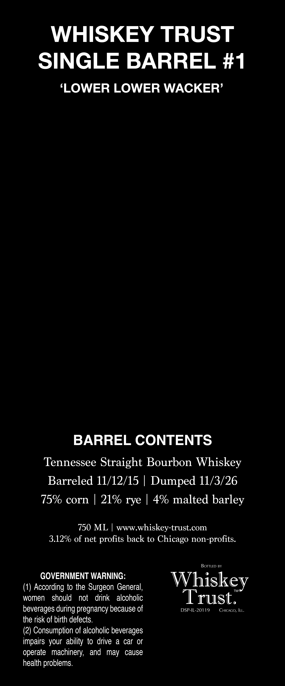
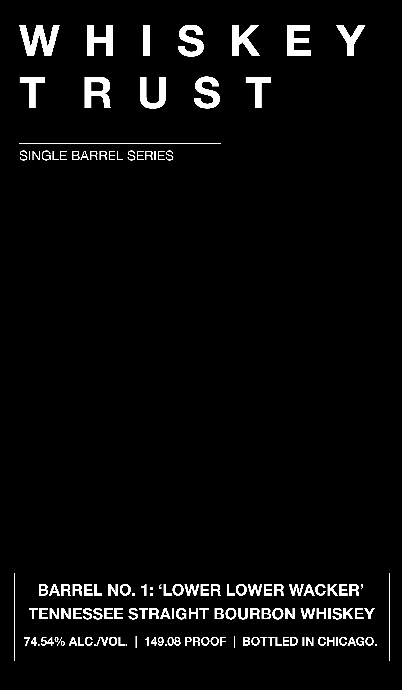

# TTB COLA Label Images - TTBID 26306001000132

**Brand Name:** WHISKEY TRUST

**Fanciful Name:** SINGLE BARREL SERIES

**Issue Date:** 11/05/2026

**Origin Code:** 43

**Product Class/Type:** 101

**Source:** [TTB Public COLA Registry](https://ttbonline.gov/colasonline/viewColaDetails.do?action=publicFormDisplay&ttbid=26306001000132)

## Label Images

### Back Label

### Front Label

## Extracted Label Text

*Text extracted via OCR - may contain errors*

**Detected Proof:** 149.1

### Back Label

WHISKEY TRUST
SINGLE BARREL #1
'LOWER LOWER WACKER'
BARREL CONTENTS
Tennessee Straight Bourbon Whiskey
Barreled 11/12/15
Dumped 11/3/26
75% corn
219 rye
4% malted barley
750 ML
wwwwhiskey-trust_com
3.12% of net profits back to Chicago non-profits:
BOTTLED BY
GOVERNMENT WARNING:
Whiskey
(1) According to the Surgeon General,
women
should
not
drink
alcoholic
Trust.
beverages
pregnancy because of
DSP-IL-20119
CHICAGO, ILL.
the risk of birth defects.
(2) Consumption of alcoholic beverages
impairs your  ability to drive
a car r
operate   machinery;
and
may
cause
health problems:
during

### Front Label

WHISKEY

TRUST

SINGLE BARREL SERIES

BARREL NO. 1: ‘LOWER LOWER WACKER’

TENNESSEE STRAIGHT BOURBON WHISKEY

74.54% ALC./VOL. | 149.08 PROOF | BOTTLED IN CHICAGO.
