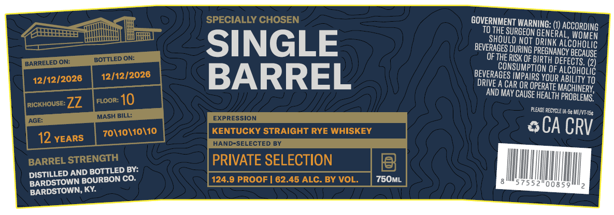

# TTB COLA Label Images - TTBID 26306001000181

**Brand Name:** BARDSTOWN BOURBON CO

**Issue Date:** 11/04/2026

**Origin Code:** 22

**Product Class/Type:** 102

**Source:** [TTB Public COLA Registry](https://ttbonline.gov/colasonline/viewColaDetails.do?action=publicFormDisplay&ttbid=26306001000181)

## Label Images

### Label 1

### Label 2

### Label 3

## Extracted Label Text

*Text extracted via OCR - may contain errors*

*2 image(s) excluded: text did not meet readability threshold*

### Label 1

GOVERNMENT WARNING: (1) AccoRDING
TOTHESURGEON GENERAL, WOMEN
SHOULD NOT ORINK ALCOHOLIC
BEVERAGES DURING PREGNANCY BECAUse
OFTHE RISK OF BIRTH DEFECTS. (7)
CONSUMPTION OF ALCoHOuiG
BEVERAGES IMPAIRS YOUR ABILITY 10
DRIVE A CAR OR OPERATE MACHINERY
REED B AND MAY CAUSE HEALTH PROBLEMS”
12/12/2026 | 1 ALISEREEU. Suerte
0 SCACRV
ZZ {ror
ISKEY
\10 KENTUCKY STRAIGHT RYE WHI vn, WWII ™ y
Reve | Ih tM]
Y'
PRIVATE SELECTION MCN,
LED AND BOTTLED BY: (EA) GRECO SEN ||
DISTILLED AND BON CO.
BARDSTOWN BO!
BARDSTOWN, KY.
