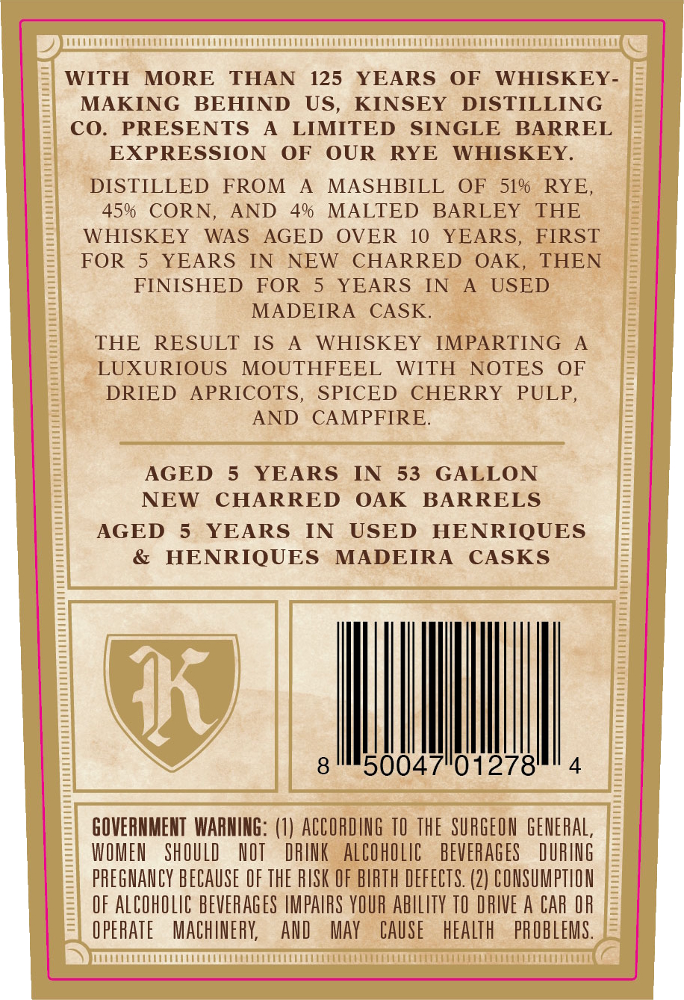
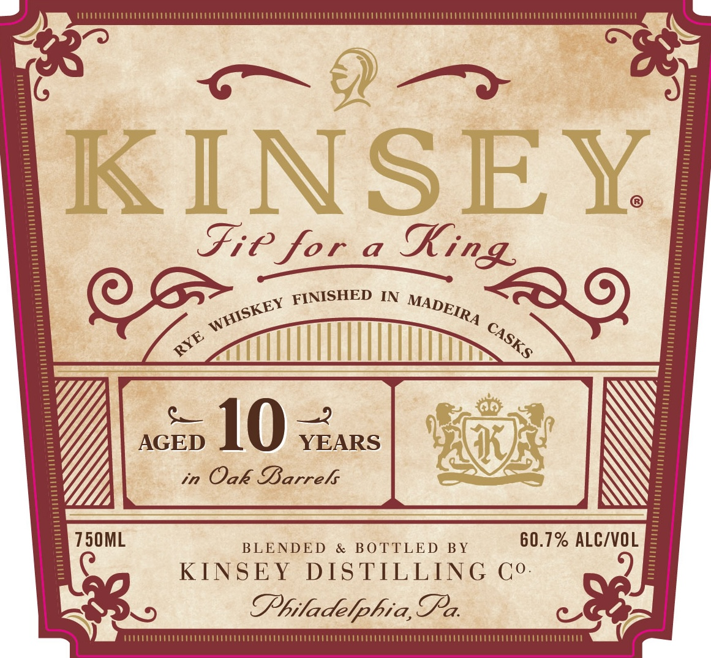
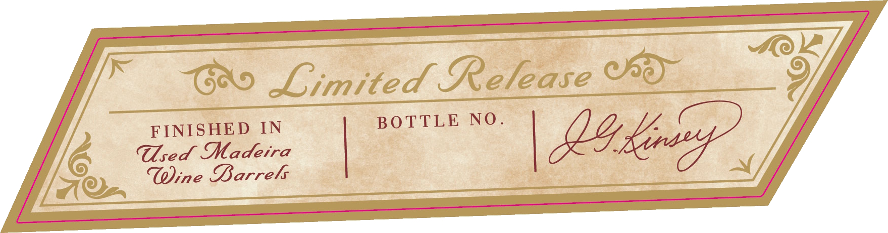

# TTB COLA Label Images - TTBID 26306001000196

**Brand Name:** KINSEY

**Issue Date:** 11/12/2026

**Origin Code:** 39

**Product Class/Type:** 142

**Source:** [TTB Public COLA Registry](https://ttbonline.gov/colasonline/viewColaDetails.do?action=publicFormDisplay&ttbid=26306001000196)

## Label Images

### Back Label

### Front Label

### Label 3

## Extracted Label Text

*Text extracted via OCR - may contain errors*

**Detected Proof:** 102
**Detected Age:** 10 Years

### Back Label

WITH
MORE
THAN
125
YEARS
OF
WHISKEY-
MAKING
BEHIND
US,
KINSEY
DISTILLING
Co.
PRESENTS
A
LIMITED
SINGLE
BARREL
EXPRESSION
OF
OUR
RYE
WHISKEY.
DISTILLED
FROM
MASHBILL
OF
51%
RYE,
45% CORN,
AND
4%
MALTED
BARLEY
THE
WHISKEY
WAS
AGED
OVER
10
YEARS,
FIRST
FOR
5
YEARS
IN
NEW
CHARRED
OAK ,
THEN
FINISHED
FOR
5
YEARS
IN
A
USED
MADEIRA
CASK:
THE
RESULT
IS
A
WHISKEY
IMPARTING
A
LUXURIOUS
MOUTHFEEL
WITH
NOTES
OF
DRIED
APRICOTS,
SPICED
CHERRY
PULP ,
AND
CAMPFIRE.
AGED
5
YEARS
IN
53
GALLON
NEW
CHARRED
OAK
BARRELS
AGED
5
YEARS
IN
USED
HENRIQUES
HENRIQUES
MADEIRA
CASKS
Ik
8
50047"01278'
GOVERNMENT  WARNING: (1) ACCORDING TO The SURGEON GENERAL;
WOMEN
ShOuLI
NOT
DRINK
alCoholic
BEVERAGES
DURING
pREGNANCY bECAUSe OF thE RISK OF BIRTH DEFECTS. (2) CONSUMPTLON
OF alCohOLIC BEVERAGES IMPAIRS YOUR abILITy TO DRIVE A CAR OR
OpERATE
MaChiNeRK
AnI
May
CAuSe
healTh
PROBLEMS.

### Front Label

KINSEY
Fie fos
a
FINISHED
IN
10
3
AGED
YEARS
in
Oak Sarrels
750ML
BLENDED
&
BOTTLED
BY
60.7 % ALCIVOL
KINSEY
DIS TILLING Co:
Shiladelphia,
King
MADEIRA
WHISKEY
CASKS
RYE
(fa:

### Label 3

_—_—____—_—

———s =

_—_—_————__—__—

Se

Se

ee

——— ee

SS

SQM

r Gao Limited Release Bs

BOTTLE NO.

FINISHED IN

Wed Madeira

by ip

Wine Barrels

See

See

SSS nnn

eee

—

——ESESE

SSS oe
