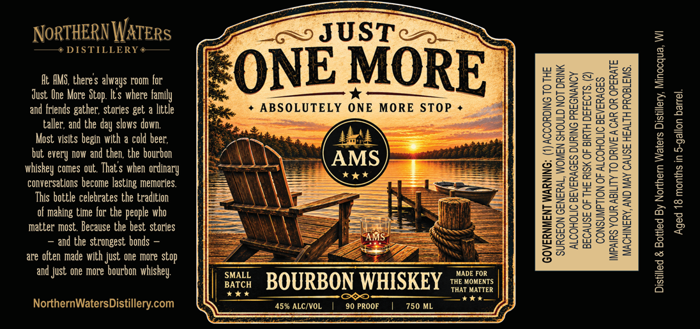

# TTB COLA Label Images - TTBID 26306001000410

**Brand Name:** JUST ONE MORE

**Issue Date:** 11/13/2026

**Origin Code:** 48

**Product Class/Type:** 141

**Source:** [TTB Public COLA Registry](https://ttbonline.gov/colasonline/viewColaDetails.do?action=publicFormDisplay&ttbid=26306001000410)

## Label Images

### Label 1

## Extracted Label Text

*Text extracted via OCR - may contain errors*

**Detected Proof:** 90

### Label 1

NorTHERN WATERS

JU

* DISTILLERY ¢

aS)

ST: Ss

Ik

At AMS, there's always room for

ONE MORE

°

Just One More Stop. It's where family

and friends gather, stories get a little

+ ABSOLUTELY ONE MORE STOP +

taller, and the day slows down.

Most visits begin with a cold beer,

pdt

Es fie

aN

but every now and then, the bourbon

MS

whiskey comes out. That's when ordinary

wee

conversations become lasting memories.

This bottle celebrates the tradition

=

\\

a |

Ls

of making time for the people who

matter most. Because the best stories

— and the strongest bonds —

“AMS

ae

are often made with just one more stop

os

|

and just one more bourbon whiskey

‘SMALL

MADE FOR

THE MOMENTS

Lee

BOURBON WHISKEY

THAT MATTER | }

tee

NorthernWatersDistillery.com

45% ALC/VOL |

90 PROOF

|

750 ML
