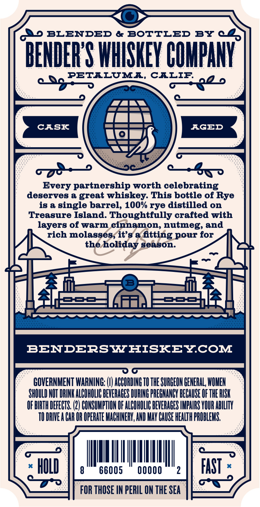
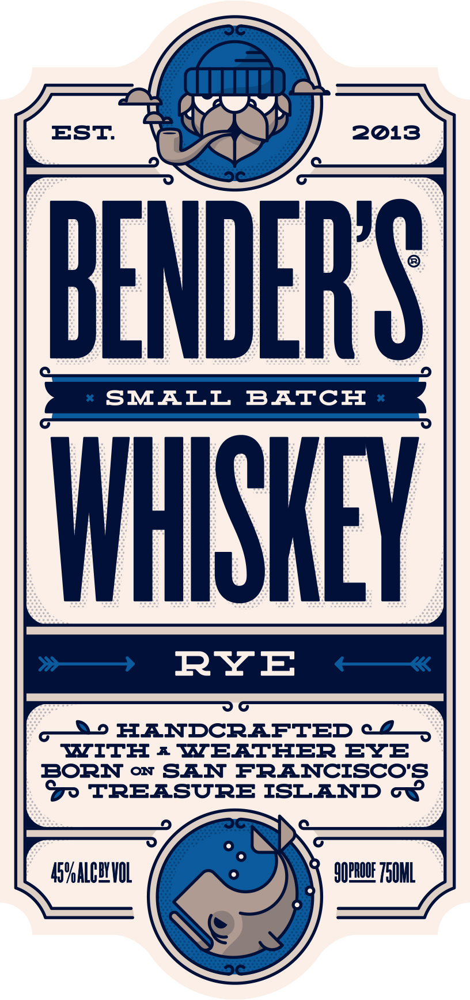
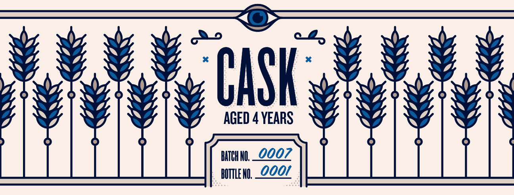

# TTB COLA Label Images - TTBID 26306001000433

**Brand Name:** BENDER'S WHISKEY

**Issue Date:** 11/09/2026

**Origin Code:** 01

**Product Class/Type:** 140

**Source:** [TTB Public COLA Registry](https://ttbonline.gov/colasonline/viewColaDetails.do?action=publicFormDisplay&ttbid=26306001000433)

## Label Images

### Back Label

### Front Label

### Label 3

## Extracted Label Text

*Text extracted via OCR - may contain errors*

**Detected Age:** 4 Years

### Back Label

I1o BLENDED & BOTTLED
BY
c2
BENDERYS WHISKEY COHPANY
PETILUMI, CILIP:
3od
CASK
AGED
Every partnership worth celebrating
deserves & great
whiskey: This bottle of Rye
is &
single barrel, 100% rye distilled on
Treasure Island: Thoughtfully crafted with
layers of warm cinnamon, nutmeg;
rich molasses;it's & ftting pour for
the
holiday Season
BENDERSWHISKEYCOM
GOVERNMENT WARNING:;
ACCORDING TO THE SURGEON HENERAL; WOMEN
SHOULD NOT DRINK ALCOHOLIC BEVERAGES DURING PREGNHNCY BECAUSE OF THE RISK
OF BIRTH DEFECTS: (2) CONSUHPTION OF ALCOHOLIC BEVERAGES IMPAIRS YOUR ABILITV
TO DRIVE A CAR OR OPERHTE MAGHINERK; AND MaY CAUSE HEALTH PROBLEMS;
HOLD
8
66005
00000
2
FAST
FOR THOSE IN PERIL ON THE SEA
and

### Front Label

EST
2013
BENDERIS
SMALI
BATCH
WHISHEY
RYE
4d HANDCRAFTED
TTITE
1
IEATEER
EY3
BORN
ON
SAN FRANCISCO'S
TREASURE ISLAND GR
45valcwVUL
9OPRQQE Z50HL
GDo

### Label 3

pa)

BABAR
GED

ASS
QD

BABAR
QED

BREAN
SD

re CASK

AGED 4 YEARS

(
v
¥
WwW)

O

BABALN
WED

BABNEN
SD

BALAN
SID

AWA WA)
