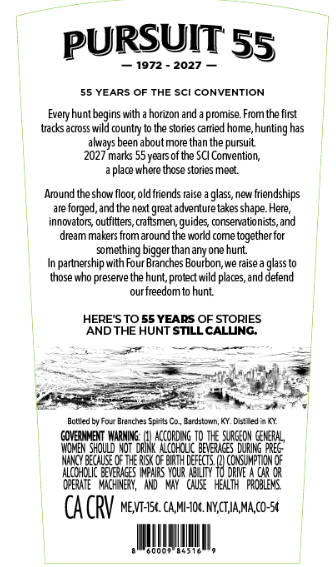
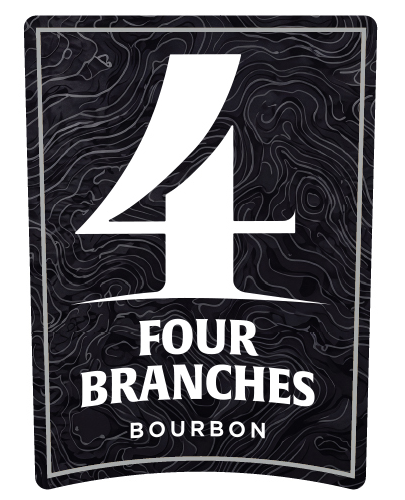
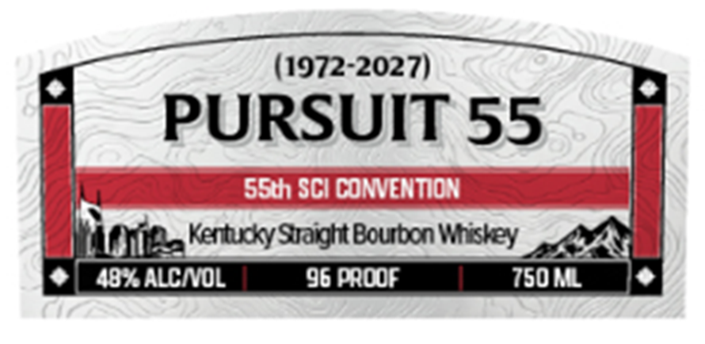
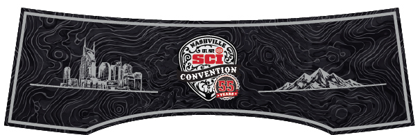

# TTB COLA Label Images - TTBID 26306001000582

**Brand Name:** FOUR BRANCHES

**Issue Date:** 11/05/2026

**Origin Code:** 22

**Product Class/Type:** 101

**Source:** [TTB Public COLA Registry](https://ttbonline.gov/colasonline/viewColaDetails.do?action=publicFormDisplay&ttbid=26306001000582)

## Label Images

### Back Label

### Label 1

### Label 2

### Label 4

### Label 5

## Extracted Label Text

*Text extracted via OCR - may contain errors*

*3 image(s) excluded: text did not meet readability threshold*

**Detected Proof:** 96

### Back Label

PURSUIT 55
1972
2027
55 YEARS OF THE Sci CONVENTION
huntbegins wiln
horuon and
promise Fiom the fltst
trcksacross wild country
Ihe slories caried home,
hunting has
always been aboutmore than the
2027 marks 55yeaisof tne SCI Corvention;
pece where ihose stories mect
Around teshow floor old iriends Iaise=
glass, new friendships
fcrged, and Ihe nexl great adventure kzkes shape Here
innovators, outfitters, caftsmen;=
'guides consewvationists,and
dream makers from around the worid come together tor
something bigger thanany one hunt
parlnership with Four Branches Bourbon;we rcise
giass (0
those who prererve thehunt;proted wild places and defend
our freedomto hunt
HERE S TO 55 YEARS OF STORIES
AND THE HUNT STILL CALUNG
EctiedLyFo- Brenona Sprbs Co
Fcamieterin
DeAio
GINEIME
HJUS UNEA
KccorD NG TQ_Ie OrGc04 cekcRLL
VIMEN
Alcohouk_bebg [RILS
E
MBUU0I
[EFECTS
#SmE
iccEDE IgMEM
DRIE
CEATE  MICHNEN,
QWr}Hilt}  FROBIEMS
CA CRV nevi-Isk cAMHok HYGTJA Maco-5X
Every
pubuil
RSd

### Label 2

(1972-20271
PURSUIT 55
s5th1 SCI CONVENTION
Kertuky Sraight Boubon Wtisley
4BKALCIVOL
96 PROOF
750ML
