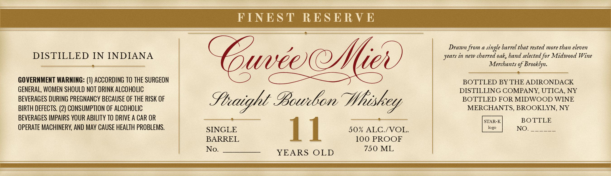

# TTB COLA Label Images - TTBID 26307001000026

**Brand Name:** CUVEE MIER

**Issue Date:** 11/05/2026

**Origin Code:** 02

**Product Class/Type:** 101

**Source:** [TTB Public COLA Registry](https://ttbonline.gov/colasonline/viewColaDetails.do?action=publicFormDisplay&ttbid=26307001000026)

## Label Images

### Label 1

## Extracted Label Text

*Text extracted via OCR - may contain errors*

**Detected Proof:** 100

### Label 1

FINEST RESERVE
————— OQ), EEE
DP ; Drawn from a single barrel that rested more than eleven
DISTILLED IN INDIANA years in new charred oak, hand selected for Midwood Wine
x Merchants of Brooklyn.
tiie Nese Sisk Se 6 ee
GOVERNMENT WARNING: (1) ACCORDING TO THE SURGEON BOTTLED BY THE ADIRONDACK
GENERAL, WOMEN SHOULD NOT DRINK ALCOHOLIC DISTILLING COMPANY, UTICA, NY
BEVERAGES DURING PREGNANCY BECAUSE OF THE RISK OF Sh: y bir Glee Whit BOTTLED FOR MIDWOOD WINE
BIRTH DEFECTS. (2) CONSUMPTION OF ALCOHOLIC 7 MERCHANTS, BROOKLYN, NY
BEVERAGES IMPAIRS YOUR ABILITY TO DRIVE A CAR OR lip aiceeeemeslisioiinssalcstins ee Sowers BOTTLE
OPERATE MACHINERY, AND MAY CAUSE HEALTH PROBLEMS. SINGLE 1 1 50% ALC./VOL. NO. Gees
BARREL 100 PROOF
No._______ YEARS OLD ae
a SR a eA RS eR ie NS
