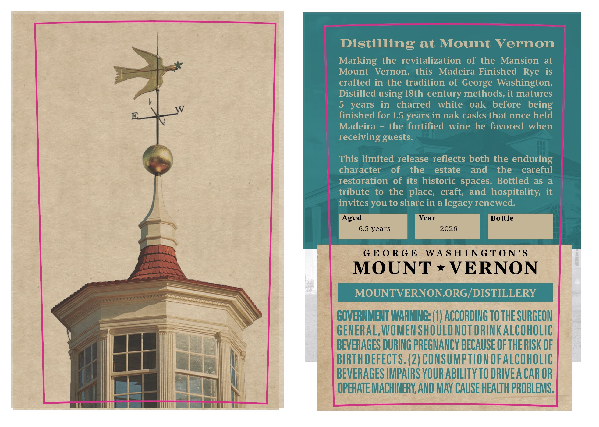
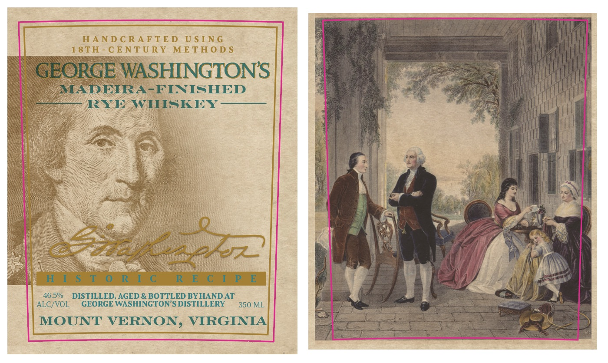
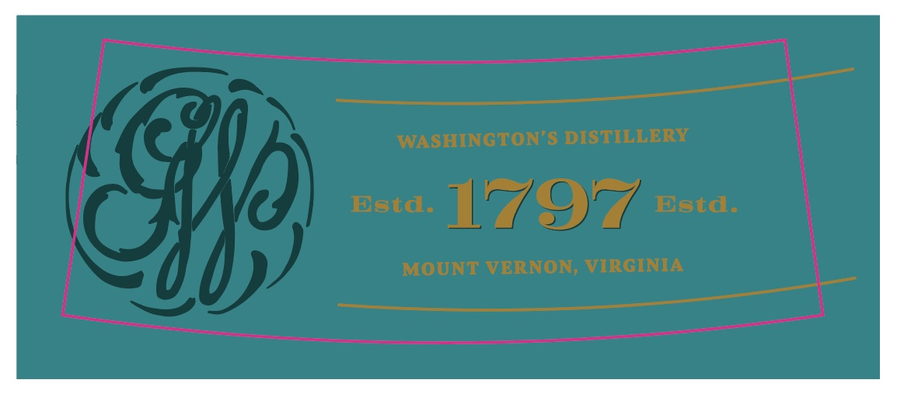

# TTB COLA Label Images - TTBID 26307001000035

**Brand Name:** GEORGE WASHINGTON'S

**Issue Date:** 11/12/2026

**Origin Code:** 05

**Product Class/Type:** 142

**Source:** [TTB Public COLA Registry](https://ttbonline.gov/colasonline/viewColaDetails.do?action=publicFormDisplay&ttbid=26307001000035)

## Label Images

### Back Label

### Front Label

### Label 2

## Extracted Label Text

*Text extracted via OCR - may contain errors*

**Detected Age:** 5 Years

### Back Label

Distilling at Mount Vernon
Marking the revitalization
of the Mansion
at
Mount
Vernon, this
Madeira-Finished
Rye
is
crafted in the tradition of George Washington.
Distilled using I8th-century methods, it matures
5
years
in
charred
white
oak
before   being
finished for 1.5 years in oak casks that once held
Madeira
the fortified wine he favored when
receiving guests.
This limited release reflects both the enduring
character
of
the
estate
and
the
careful
restoration of its historic spaces: Bottled
as
a
tribute to
the place, craft,
and hospitality;
it
invites you to share in a legacy renewed:
Aged
Year
Bottle
6.5 years
2026
G E 0 RG E
WA S HI NG TON'S
MOUNT
VERNON
MOUNTVERNON.ORG/DISTILLERY
GOVERNMENT WARNING: (0) ACCORDING TO THE SURGEON
GENERAL, WOMENSHOULD NOT DRINKALCOhOLIC
BEVERAGES DURING PREGNANCY BECAUSE OF THE RISK OF
BIRTHDEFECTS. (2) CONSUMPTION OFAlcohOlic
BEVERAGES IMPAIRS VOUR ABILITY TO DRIVEA CAR OR
OPERATE MACHINERY AND MAY CAUSE HEALTH PROBLEMS.

### Front Label

ain

ee

HANDCRAFTED USING

18TH-CENTURY METHODS

ASHINGTON'S

ee

-FINISHED

Lie

vl

RYE WHISKEY

Y

fi

i)

ay

ae

ar

a4

eat

“«

Fr

vie

0

OP

rt

\

74

i |

ih

\\

te

"i

m

w

a

ater

WI)

46.5% DISTILLED, AGED & BOTTLED BY HAND AT

‘ALC/VOL

GEORGE WASHINGTON’S DISTILLERY

350 ML

MOUNT VERNON, VIRGINIA

ais

to

### Label 2

WASHINGTON § DISTILLERY
Hstd. i| { — Estd
e y d.

MOUNT VERNON, VIRGINIA
