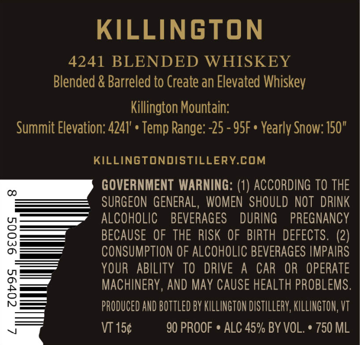
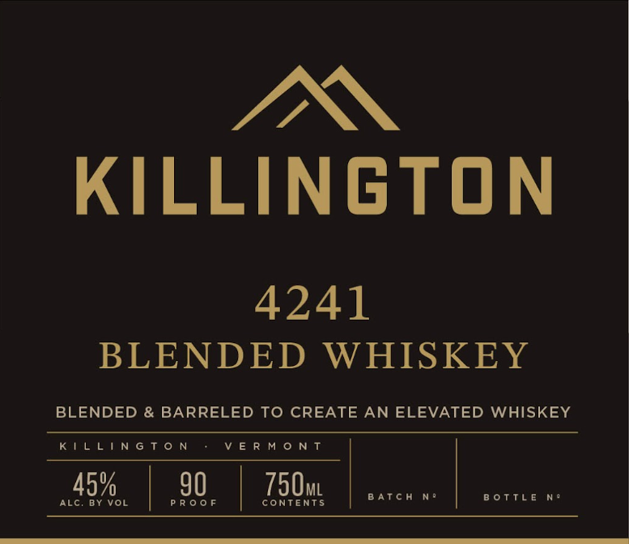
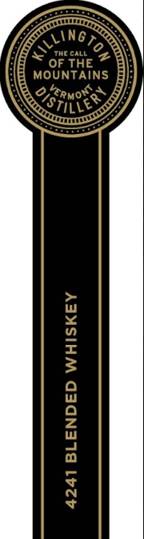

# TTB COLA Label Images - TTBID 26307001000118

**Brand Name:** KILLINGTON DISTILLERY

**Fanciful Name:** 4241 BLENDED WHISKEY

**Issue Date:** 11/05/2026

**Origin Code:** 46

**Product Class/Type:** 137

**Source:** [TTB Public COLA Registry](https://ttbonline.gov/colasonline/viewColaDetails.do?action=publicFormDisplay&ttbid=26307001000118)

## Label Images

### Back Label

### Front Label

### Label 2

## Extracted Label Text

*Text extracted via OCR - may contain errors*

*1 image(s) excluded: text did not meet readability threshold*

**Detected Proof:** 90

### Back Label

KILLINGTON
4241 BLENDED WHISKEY
Blended & Barreled to Create an Elevated Whiskey
Killington Mountain:
Summit Elevation: 4241' + Temp Range:-25 - 95F . Yearly Snow: 150"
KILLINGTONDISTILLERYCOM
GOVERNMENT WARNING: (1) ACCORDING TO THE
00
SURGEON  GENERAL,  WOMEN  SHOULD NOT  DRINK
ALCOHOLIC
BEVERAGES
DURING
PREGNANCY
3
BECAUSE OF THE RISK OF BIRTH DEFECTS. (2)
CONSUMPTION OF ALCOHOLIC BEVERAGES IMPAIRS
YOUR   ABILITY
TO   DRIVE
A
CAR
OR   OPERATE
8
MACHINERY, AND May CAUSE HEALTH PROBLEMS.
PRODUCED AND BOTTLED BY KILLINGTON distillery; KILLINGTON, VT
V
VT 150
90 PROOF
ALC 45% BY VOL.
750 ML

### Front Label

IN

KILLINGTON

4241

BLENDED WHISKEY

BLENDED & BARRELED TO CREATE AN ELEVATED WHISKEY

KILLINGTON VERMONT

BOTTLE N
