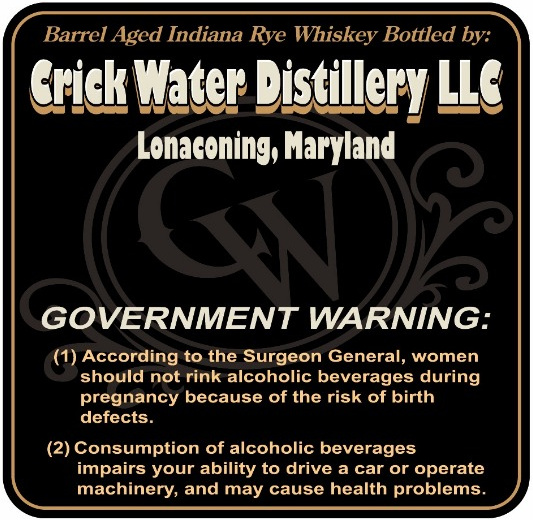
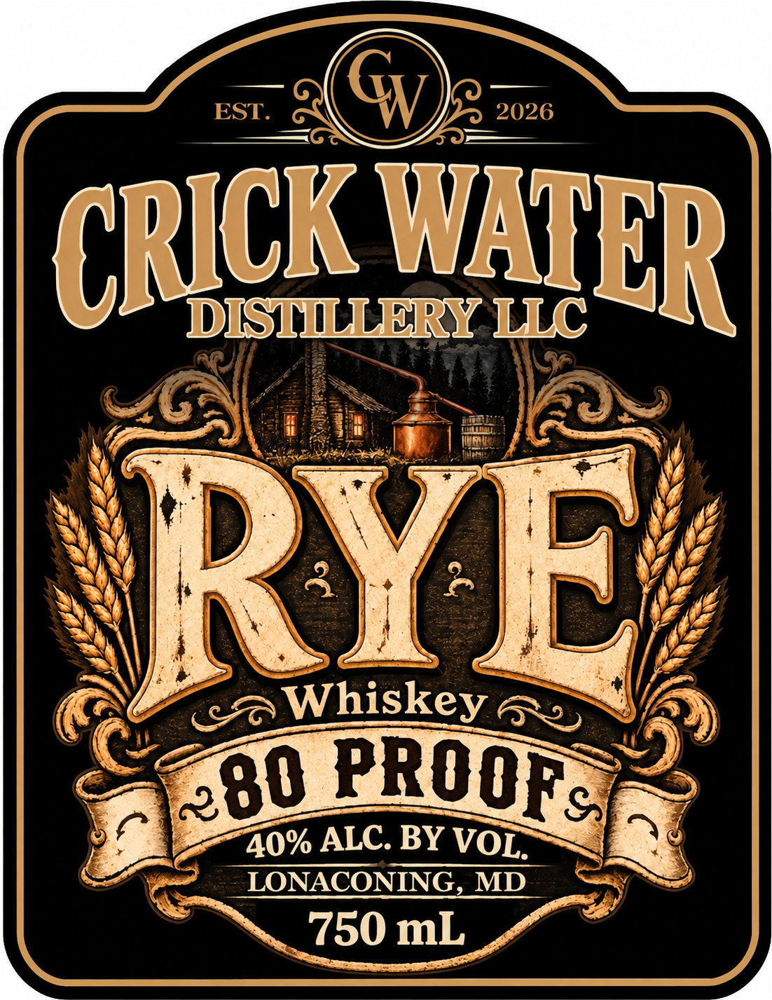
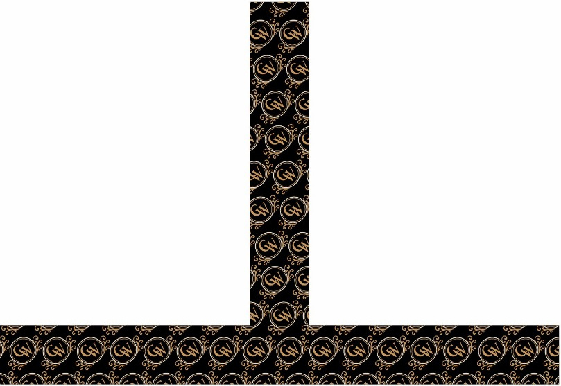

# TTB COLA Label Images - TTBID 26307001000120

**Brand Name:** RYE WHISKEY

**Issue Date:** 11/05/2026

**Origin Code:** 25

**Product Class/Type:** 142

**Source:** [TTB Public COLA Registry](https://ttbonline.gov/colasonline/viewColaDetails.do?action=publicFormDisplay&ttbid=26307001000120)

## Label Images

### Back Label

### Front Label

### Label 3

## Extracted Label Text

*Text extracted via OCR - may contain errors*

*1 image(s) excluded: text did not meet readability threshold*

**Detected Proof:** 80

### Back Label

Barrel Aged Indiana Rye Whiskey Bottled by:
Yrick Water Distillery LLG
Lonaconing; Maryland
GOVERNMENT WARNING:
According to the Surgeon General, women
should not rink alcoholic beverages during
pregnancy because of the risk of birth
defects.
(2) Consumption of alcoholic beverages
impairs your ability to drive a car or operate
machinery; and may cause health problems.

### Front Label

EST.
2026
DISTLERY LLC
RYE
Whiskey
40% ALC. BY
LONACONING, MD
750 mL
G
WATER
CRICK
PROOFs
280
VOL:
