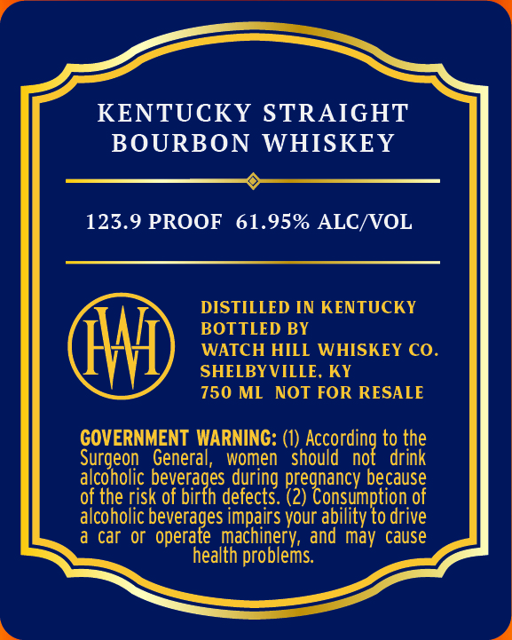
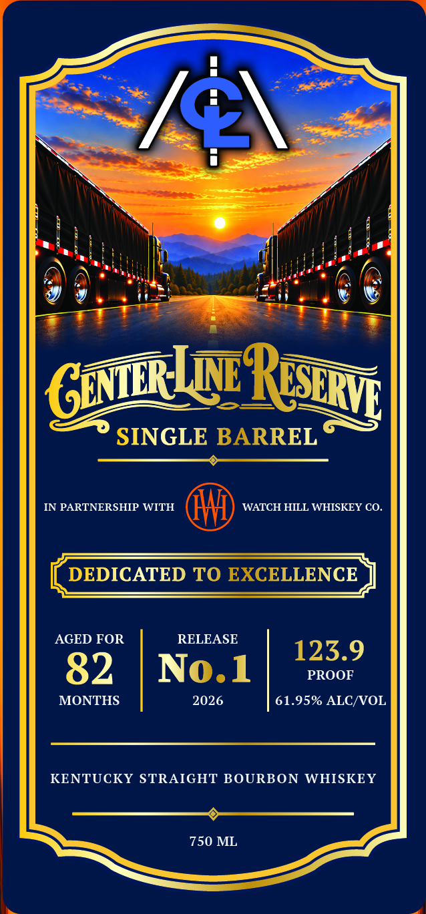

# TTB COLA Label Images - TTBID 26307001000184

**Brand Name:** CENTER-LINE RESERVE

**Fanciful Name:** SINGLE BARREL

**Issue Date:** 11/06/2026

**Origin Code:** 22

**Product Class/Type:** 101

**Source:** [TTB Public COLA Registry](https://ttbonline.gov/colasonline/viewColaDetails.do?action=publicFormDisplay&ttbid=26307001000184)

## Label Images

### Back Label

### Front Label

## Extracted Label Text

*Text extracted via OCR - may contain errors*

**Detected Proof:** 123.9

### Back Label

KENTUCKY STRAIGHT
BOURBON
WHISKEY
123.9 PROOF
61.95% ALC/VOL
DISTILLED IN KENTUCKY
BOTTLED BY
WATCH HILL WHISKEY CO
SHELBYVILLE, KY
750 ML
NOT FOR RESALE
GOVERNMENT WARNING: (1)
hoccordiog
to the
Surgeon
General,
women
should
drink
alcoholic
during
because
of the risk
bevexades
of
defects_
Pzezoascw
of
alcoholic beverages impairs your
Cabsikypoors
drive
car Or
operate  machinery; and may cause
health problems

### Front Label

K1
SINGLE BARREL
IN PARTNERSHIP WITH
WATCH HILL WHISKEY CO_
DEDICATED TO EXCELLENCE
AGED FOR
RELEASE
123.9
82
No.1
PROOF
MONTHS
2026
61.95% ALCNVOL
KENTUCKY STRAIGHT BOURBON
WHISKEY
750 ML
ReSeRV
GeNLRLu
