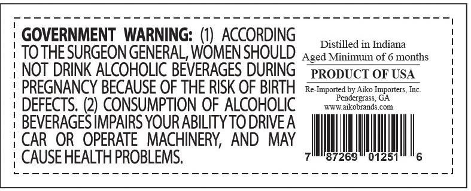
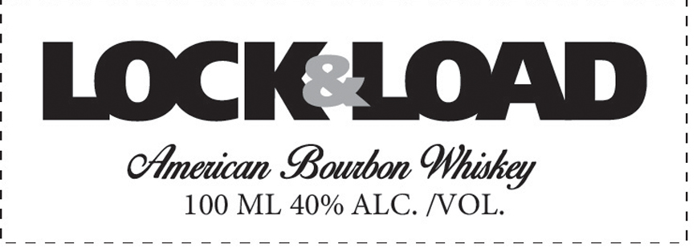
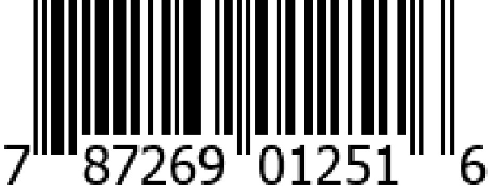

# TTB COLA Label Images - TTBID 26307001000326

**Brand Name:** LOCK & LOAD

**Issue Date:** 11/13/2026

**Origin Code:** 00

**Product Class/Type:** 141

**Source:** [TTB Public COLA Registry](https://ttbonline.gov/colasonline/viewColaDetails.do?action=publicFormDisplay&ttbid=26307001000326)

## Label Images

### Back Label

### Front Label

### Label 3

## Extracted Label Text

*Text extracted via OCR - may contain errors*

*1 image(s) excluded: text did not meet readability threshold*

**Detected Proof:** 80

### Back Label

GOVERNMENT   WARNING: (0) ACCORDING
Distilled in Indiana
TOTHE SURGEON GENERAL WOMEN SHOULD Aged Miniun of
months
NOT DRINK ALCOHOLIC BEVERAGES DURING
PRODUCT OF USA
PREGNANCY BECAUSE OF THE RISK OF BIRTH
Re-Imported by Aiko Importers; Inc
Pendergrass, GA
DEFECTS. (2) CONSUMPTION OF ALCOHOLIC
WWWaiobrands com
BEVERAGES IMPAIRS YOUR ABILITY TODRIVEA
CAR OR  OPERATE MACHINERY, AND MAY
CAUSE HEALTH PROBLEMS,
87269
01251

### Front Label

LOCICLOAD

CAneucan Bouton Whiskey

pirat Enea ME ES ER Re ES EO Ee Et

100 ML 40% ALC. meee
