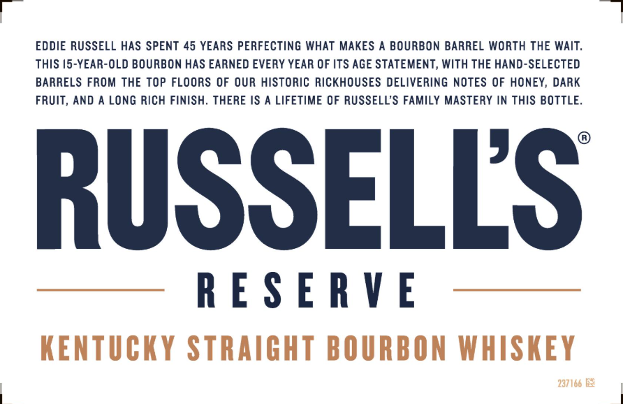
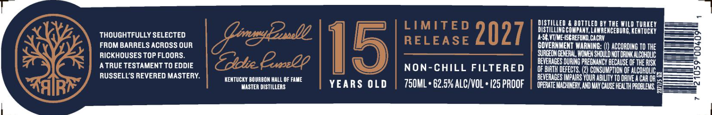
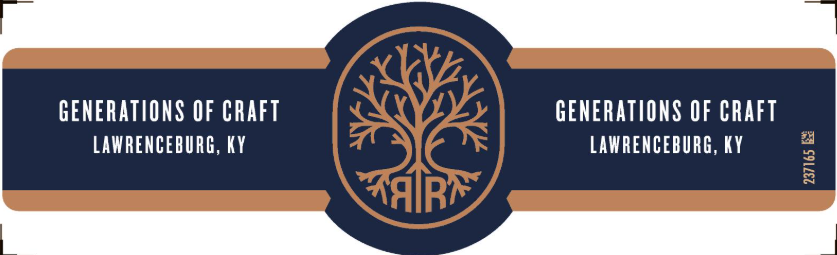

# TTB COLA Label Images - TTBID 26307001000453

**Brand Name:** RUSSELL'S RESERVE

**Fanciful Name:** 15 YEARS OLD

**Issue Date:** 11/10/2026

**Origin Code:** 22

**Product Class/Type:** 101

**Source:** [TTB Public COLA Registry](https://ttbonline.gov/colasonline/viewColaDetails.do?action=publicFormDisplay&ttbid=26307001000453)

## Label Images

### Label 1

### Label 2

### Label 3

## Extracted Label Text

*Text extracted via OCR - may contain errors*

*1 image(s) excluded: text did not meet readability threshold*

**Detected Proof:** 125
**Detected Age:** 45 Years

### Label 1

EDDIE RUSSELL HAS SPENT 45 YEARS PERFECTING WHAT MAKES A BOURBON BARREL WORTH THE WAIT.

THIS 15-YEAR-OLD BOURBON HAS EARNED EVERY YEAR OF ITS AGE STATEMENT, WITH THE HAND-SELECTED

BARRELS FROM THE TOP FLOORS OF OUR HISTORIC RICKHOUSES DELIVERING NOTES OF HONEY, DARK

FRUIT, AND A LONG RICH FINISH. THERE IS A LIFETIME OF RUSSELL’S FAMILY MASTERY IN THIS BOTTLE.

RUSSELLS

RESERVE

KENTUCKY STRAIGHT BOURBON WHISKEY

237166 BE

### Label 2

LIMITED
DISIILLED 4 dotiled bL IhE Wild IuakEY
THOUGHTFULLY SELECTED
Gmzybesslc
2027
IThMGghEUng CigaenceburG ReATuery
FROM BARRELS ACROSS OUR
15
RELEASE
GOVERNMENT WARNING: () ACCORDING TO ihe
RICKHOUSES TOP FLOORS
SURGEON GeNeRAL Mowen Should NoT daITalCOhDLIC
ATRUE TESTAMENT TO EDDIE
Edie Ep2o
non-CHILL FILTERED
beveruGeS DURING PREGMANCY BECAUSE OF ThE RISI
QF BIATH DEFECTS. (2) CONSuMptIOn OF Alcoholic
RUSSELLS REVERED MASTERY
KENTUCKY BOURDON HALL OF FAME
BEVERAGES IMPARS YOUR ABILITY TO DAIVE ^ Car OR
MASTEA DISTILLERS
YEARS OLD
750ML ' 62.5% ALCIVOL ' [25 PROOF
operate MAChNeRY,AND MaY CauSe HELTH prdblems
