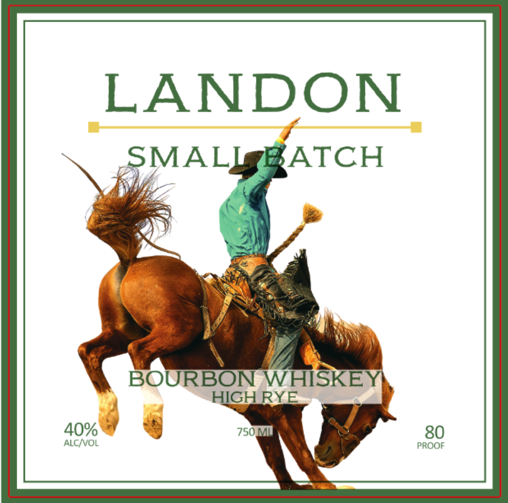
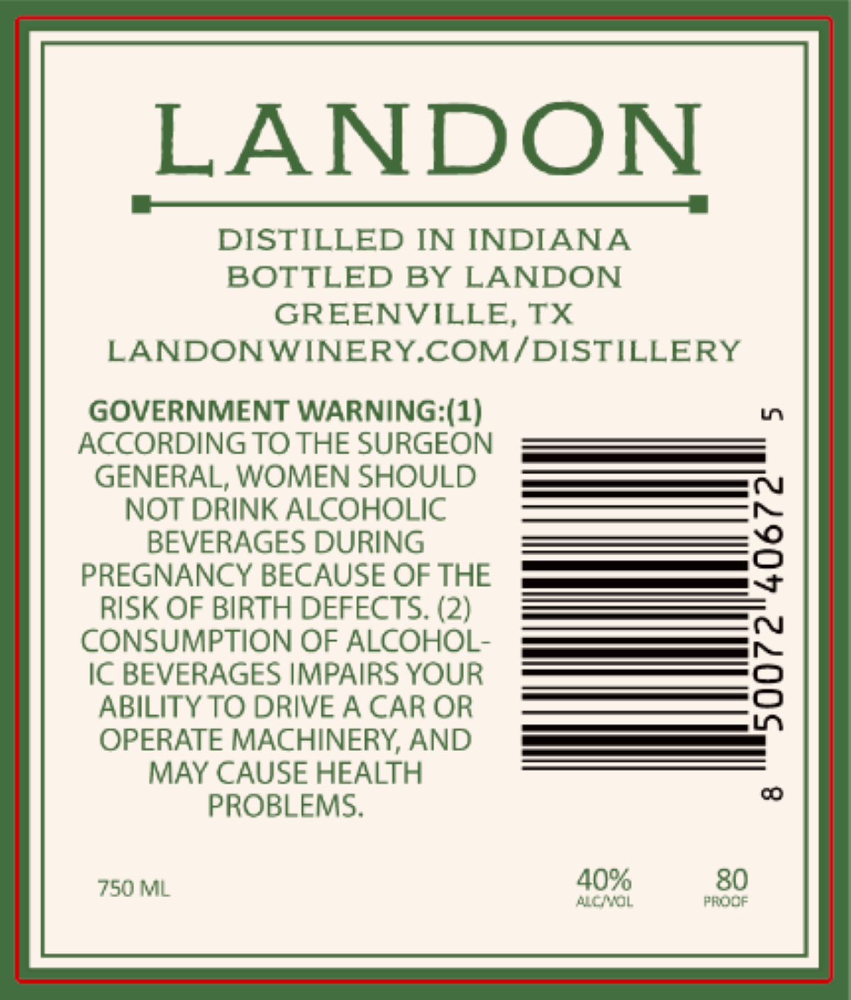

# TTB COLA Label Images - TTBID 26307001000527

**Brand Name:** LANDON

**Issue Date:** 11/10/2026

**Origin Code:** 44

**Product Class/Type:** 141

**Source:** [TTB Public COLA Registry](https://ttbonline.gov/colasonline/viewColaDetails.do?action=publicFormDisplay&ttbid=26307001000527)

## Label Images

### Back Label

### Front Label

## Extracted Label Text

*Text extracted via OCR - may contain errors*

**Detected Proof:** 80

### Back Label

LANDON
SMALI
ATCH
BOURBON WHISKEY
HIGH RYE
40%
750M
80
ALC NVOL
PROOF

### Front Label

LANDON
DISTILLED IN INDIANA
BOTTLED BY LANDON
GREENVILLE, TX
LANDONWINERY COM/DISTILLERY
GOVERNMENT WARNING (1)
L7
ACCORDING TO THE SURGEON
GENERAL; WOMEN SHOULD
NOT DRINK ALCOHOLIC
BEVERAGES DURING
3
PREGNANCY BECAUSE OF THE
RISK OF BIRTH DEFECTS. (2)
CONSUMPTION OF ALCOHOL-
IC BEVERAGES IMPAIRS YOUR
8
ABILITY TO DRIVE A CAR OR
OPERATE MACHINERY; AND
MAY CAUSE HEALTH
00
PROBLEMS_
750ML
40%
80
ACMOL
FRODF
