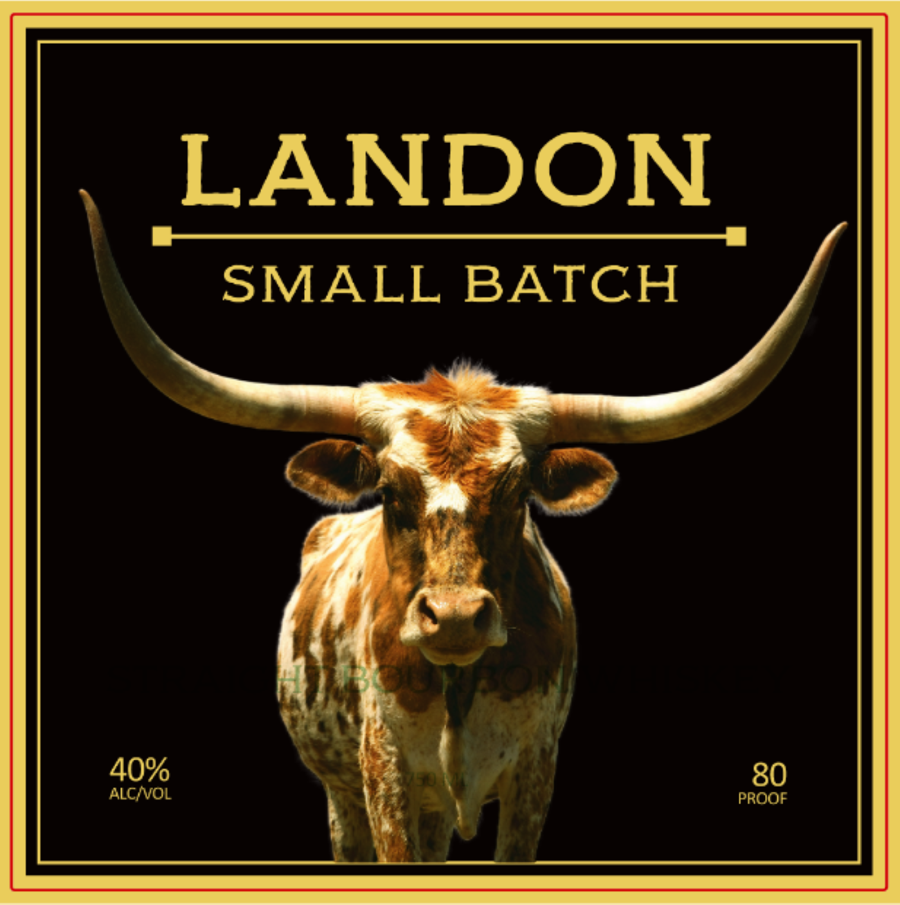
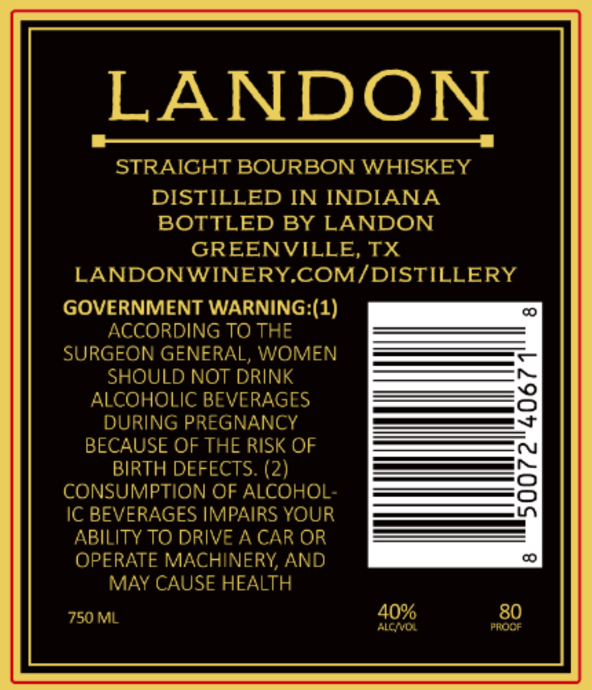

# TTB COLA Label Images - TTBID 26307001000531

**Brand Name:** LANDON

**Issue Date:** 11/10/2026

**Origin Code:** 44

**Product Class/Type:** 101

**Source:** [TTB Public COLA Registry](https://ttbonline.gov/colasonline/viewColaDetails.do?action=publicFormDisplay&ttbid=26307001000531)

## Label Images

### Back Label

### Front Label

## Extracted Label Text

*Text extracted via OCR - may contain errors*

**Detected Proof:** 80

### Back Label

LANDON
SMALL
BATCH
40%
80
ALCNVOL
PROOF

### Front Label

LANDON
STRAICHT BOURBON WHISKEY
DISTILLED IN INDIANA
BOTTLED BY LANDON
GREENVILLE
TX
LANDONWINERYCOMIDISTILLERY
GOVERNMENT WARNING:(1)
ACCORDING TO THE
SURGEON GENERAL, WOMEN
SHOULD NOT DRINK
ALCOHOLIC BEVERAGES
8
DURING PREGNANCY
BECAUSE OF THE RISK OF
BIRTH DEFECTS. (2)
8
CONSUMPTION OF ALCOHOL-
IC BEVERAGES IMPAIRS YOUR
ABILITY TO DRIVE A CAR OR
OPERATE MACHINERY, AND
MAY CAUSE HEALTH
750ML
40%
80
ACNDL
FROCF
