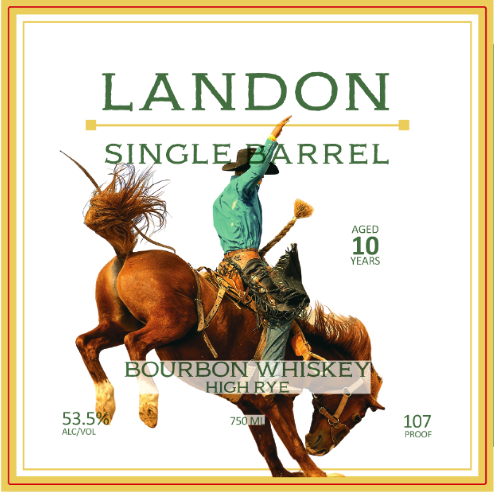
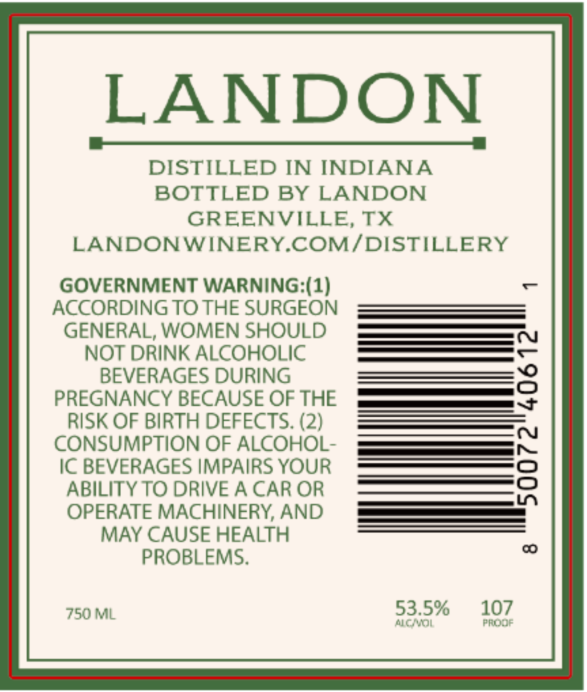

# TTB COLA Label Images - TTBID 26307001000547

**Brand Name:** LANDON

**Issue Date:** 11/10/2026

**Origin Code:** 44

**Product Class/Type:** 141

**Source:** [TTB Public COLA Registry](https://ttbonline.gov/colasonline/viewColaDetails.do?action=publicFormDisplay&ttbid=26307001000547)

## Label Images

### Back Label

### Front Label

## Extracted Label Text

*Text extracted via OCR - may contain errors*

**Detected Proof:** 107
**Detected Age:** 10 Years

### Back Label

LANDON
SINGLE
ARREL
AGED
10
YEARS
BOURBON WHISKE
HGH RYE
53.5%
750m
107
ALCNOL
PROOF

### Front Label

LANDON
DISTILLED IN INDIANA
BOTTLED BY LANDON
GREENVILLE, TX
LANDONWINERYCOM/DISTILLERY
GOVERNMENT WARNING (1)
AcCORDING TO THE SURGEON
GENERAL, WOMEN SHOULD
NOT DRINK ALCOHOLIC
BEVERAGES DURING
8
PREGNANCY BECAUSE OF THE
RISK OF BIRTH DEFECTS. (2)
CONSUMPTION OF ALCOHOL-
IC BEVERAGES IMPAIRS YOUR
8
ABILITY TO DRIVE A CAR OR
OPERATE MACHINERY; AND
MAY CAUSE HEALTH
c
PROBLEMS.
750 ML
53.5%
107
aci
FROMF
