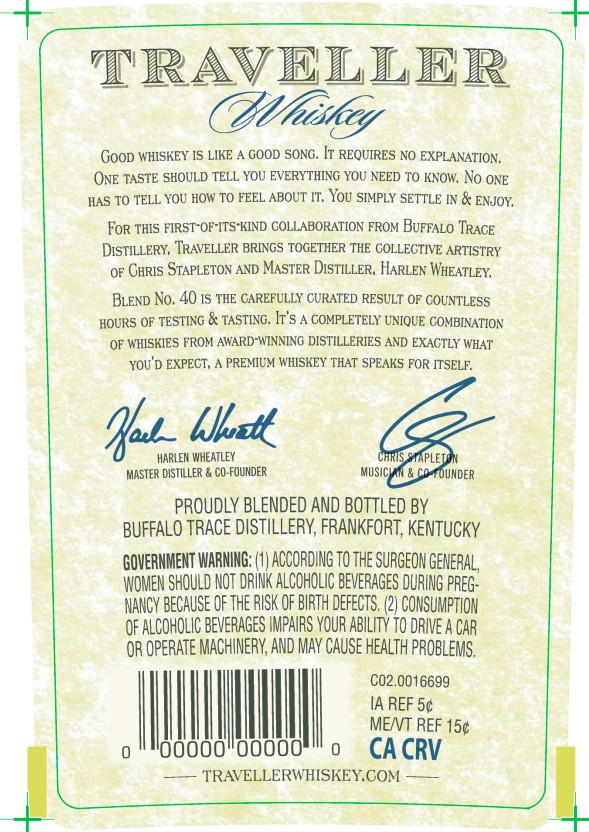
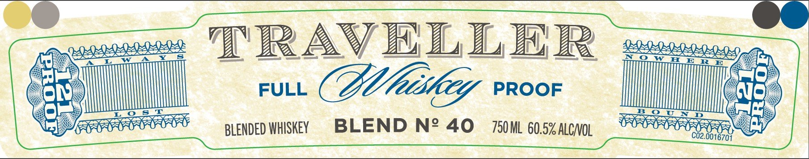
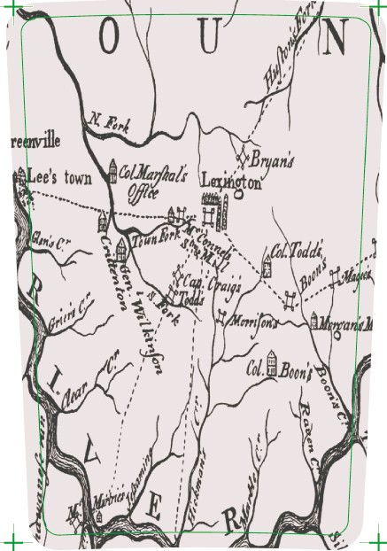
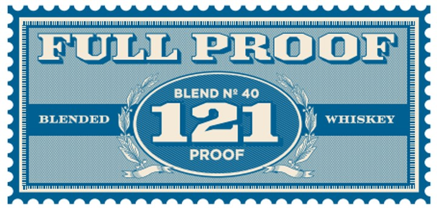

# TTB COLA Label Images - TTBID 26307001000561

**Brand Name:** TRAVELLER

**Fanciful Name:** FULL PROOF

**Issue Date:** 11/06/2026

**Origin Code:** 22

**Product Class/Type:** 137

**Source:** [TTB Public COLA Registry](https://ttbonline.gov/colasonline/viewColaDetails.do?action=publicFormDisplay&ttbid=26307001000561)

## Label Images

### Back Label

### Front Label

### Label 2

### Label 4

## Extracted Label Text

*Text extracted via OCR - may contain errors*

**Detected Proof:** 121

### Back Label

TRAVELLER
Cfhiskey
GooD WHISKEY IS LIKE
GOOD SONG. IT REQUIRES NO EXPLANATION ,
ONE TASTE SHOULD TELL YOU EVERYTHING YOU NEED TO KNOW; No ONE
HAS TO TELL YOU HOW TO FEEL ABOUT IT, You SIMPLY SETTLE IN & ENJOY;
FoR THIS FIRST-OF-ITS-KIND COLLABORATION FROM BUFFALO 'IRACE
DISTILLERY; TRAVELLER BRINGS TOGETHER THE COLLECTIVE ARTISTRY
OF GHRIS STAPLETON AVD MASTER DISTILLER, HARLEN WHEATLEY
BLEND No, 40 IS THE CAREFULLY CURATED RESULT OF COUNTLESS
HOURS OF TESTING & TASTING, It'5
COMPLETELY UNIQUE COMBINATION
OF WHISKIES FROM AWARD-WINNING DISTILLERIES AND EXACTLY WHAT
YOU D EXPECT;
PREMIUM WHISKEY THAT SPEAKS FOR ITSELE;
Hu__Ulatt
HARLEM WHEATLEY
CHRUS STAPLETC
MASTfR DistILLeR
CO-FOUNDER
Musichah & cO FDUNDER
PROUDLY BLENDED AND BOTTLED BY
BUFFALO TRACE DISTILLERY, FRANKFORT, KenTUCKY
GOVERNMENT WARNING:
ACCORDING TO thE SURGEON GENERAL,
WOMEN SHOULD NOT DRINK ALCOHOLIC beveraGES DURING PREG:
NANCY BECAUSE OF thE RISK oF BIRTH Defects. (2| CONSUMPTION
OF ALCOHOLIC BEVERAGES IMPHIRS VOUR ABiLIty TO DRIVE A CAR:
OR opeRATE MACHINERV; AND MAV Cause Health PROBLEMS,
C02.0016699
IA REF 5c
MENT REF 15c
Ooooo
CA CRV
TRAVELLERWHISKEYCOM

### Front Label

Al)

!

BAAS

ODA

A}

aes

——

Al

—

i

“aA

ZAN

2D)

NO

S.88.05,

EA AA

AAS

AA

IVIS ISIS

mI"

wo

(a

oh:

FULL

Cig PROOF

Us)

faxes

SSS

comced

ICICI

eeveeveevenvenvanvent,

yy

WR

alata

cy

BLENDED WHISKEY

BLEND N2 40 750M. 60.5% ALcv01

OY)

AAA AR pees

C02.0016704

[-47

### Label 2

N Bbrk
reawville
Bryans
Lee s town
ulfadl; Lagaz
Gw€r
Gol oddi
Falqi
Mmifry
CoLRBoonh
I Moc
E
R
Bvon-
Vriri
lrganah

### Label 4

FULL PROOF
BLEND N' 40
BLENDED
121
WHISKEY
PROOF
