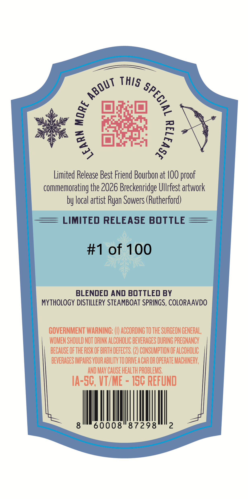
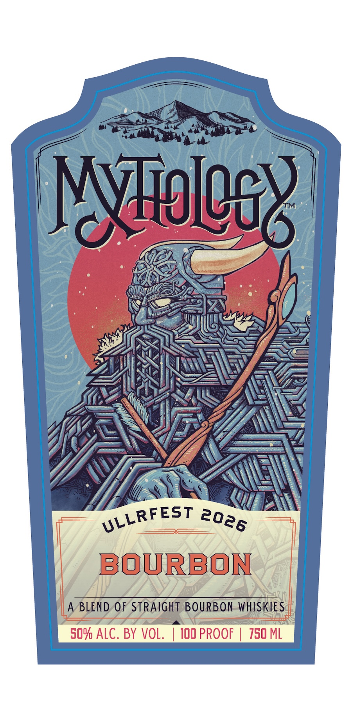

# TTB COLA Label Images - TTBID 26307001000811

**Brand Name:** MYTHOLOGY

**Issue Date:** 11/20/2026

**Origin Code:** 13

**Product Class/Type:** 121

**Source:** [TTB Public COLA Registry](https://ttbonline.gov/colasonline/viewColaDetails.do?action=publicFormDisplay&ttbid=26307001000811)

## Label Images

### Back Label

### Label 1

## Extracted Label Text

*Text extracted via OCR - may contain errors*

**Detected Proof:** 100

### Back Label

Limited Release Best Friend Bourbon at |0O
commemorating the 2026 Breckenridge Ullrfest artwork
by local artist Ryan Sowers (Rutherford)
LIMITED RELEASE BOTTLE
#1 of 100
BLENDED AND BOTTLED BY
MYTHOLOGY DISTILLERY STEAMBOAT SPRINGS, COLORAAVDO
GOVERNMENT WARNING:
ACCORDING TO THE SURGEON GENERAL;
WOMEN SHOULD NOT DRINK ALCOHOLIC BEVERAGES DURING PREGNANCV
BECAUSE OFTHE RISK OF BIRTH DEFECTS;, (2) CONSUMPTHON OF ALCOHOLIC
BEVERAGES IMPAIRS VOUR ABILITV TO DRIVE A CAR OR OPERATE MACHINERV;
AND MAv CAUSE HEALTH PROBLEMS
Ia-5C, VT/ME
I50 REFuND
8
60008
87298
2
This
ABOUT
1
1
1
1
proof

### Label 1

Mvliles
BOURBON
A BLEND OF STRAIGHT BOURBON WHISKIES
so% ALC. BY VOL.
100 PROOF
750 ML
ULLRFEST
2026
