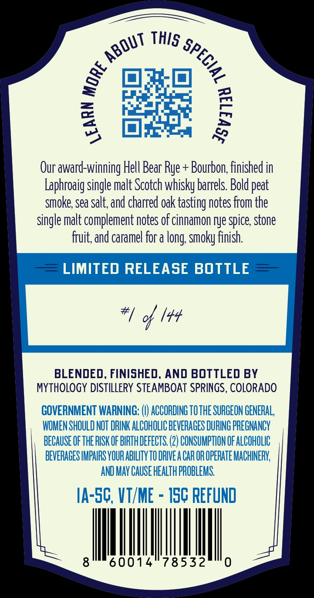
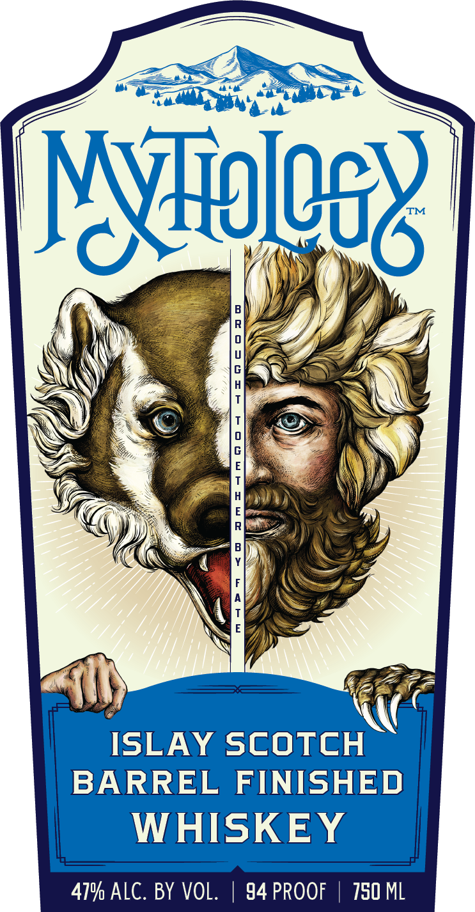

# TTB COLA Label Images - TTBID 26307001000828

**Brand Name:** MYTHOLOGY

**Fanciful Name:** BROUGHT TOGETHER BY FATE

**Issue Date:** 11/17/2026

**Origin Code:** 13

**Product Class/Type:** 140

**Source:** [TTB Public COLA Registry](https://ttbonline.gov/colasonline/viewColaDetails.do?action=publicFormDisplay&ttbid=26307001000828)

## Label Images

### Back Label

### Front Label

## Extracted Label Text

*Text extracted via OCR - may contain errors*

**Detected Proof:** 82

### Back Label

Our award-winning Hell Bear Rye + Bourbon; finished in
Laphroaig single malt Scotch whisky barrels Boldpeat
smoke Sea Salt and charred oak tasting notes from the
single malt complement notes of cinnamon rye spice; stone
fruit,and caramel for &
smoky finish
LIMITED RELEASE BOTTLE
#/
% 144
BLENDED, FINISHED, AND BOTTLED BY
MYTHOLOGY DISTILLERY STEAMBOAT SPRINGS, COLORADO
GOVERNMENT WARNING:
ACCORDING TOTHE SURGEON GENERAL,
WOMEN SHOULD NOT DRINK ALCOHOLIC BEVERAGES DURING PREGNANCY
BECAUSE OF THE RISK OF BIRTH DEFECTS (2) CONSUMPTHON OF ALCOHOLIC
BEVERAGES IMPHIRS YOUR ABILITY TO DRIVEA CAR OR OPERATE MACHINERY;
AND MAY CAUSE HEALTH PROBLEMS
IA-SG, VT/ME
I5G Refund
8
60014
78532
ThIS
ABOUT
SPECIAL
1
1
9
long:;

### Front Label

(| a’ YSZ
ISLAY SCOTCH
BARREL FINISHED
| WHISKEY
41% ALC. BY VOL. | 94 PROOF | 750 ML
