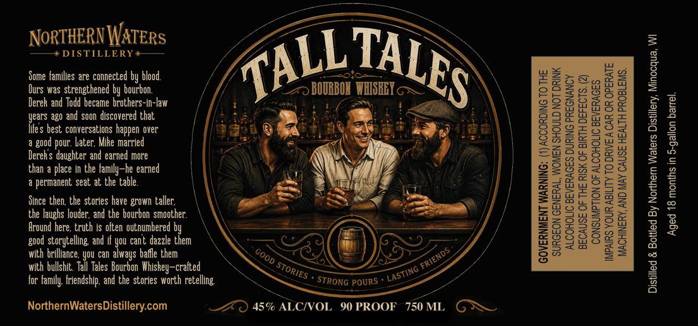

# TTB COLA Label Images - TTBID 26307001000867

**Brand Name:** TALL TALES

**Issue Date:** 11/06/2026

**Origin Code:** 48

**Product Class/Type:** 141

**Source:** [TTB Public COLA Registry](https://ttbonline.gov/colasonline/viewColaDetails.do?action=publicFormDisplay&ttbid=26307001000867)

## Label Images

### Label 1

## Extracted Label Text

*Text extracted via OCR - may contain errors*

### Label 1

NoRTHERNWATERs
2
DISTILLERY
Some families are connected by blood
3
1
Ours was strengthened by bourbon
BOUBBOL   WHISBEI =
Denk and Indi bArzns Argke Cha-lav
HM
01
Hes bepouanaeezEiane laanee over
1
{
pour ,
Derek $ daughter and earned more
2
2
tipernatere J &ke Lik ~Zbeeared
H
1
1
94
Since then; the stories have grown taller;,
8
0
Ekauhdgier kucethand dbe  ourbonbeneather
Hu
1
2
storytelling  and
You
dazzle
tuem
1
3
with brilliance , You can always bafle them
with bullshit  Tall
Bourbon WhisRey-cralted
for Family: friendship ; and the stories worth retelling
STRONG POURS
3
NorthernWatersDistillery com
459 ALCIVOL  9 PROOF
750 ML
TALES
TALL
good
good
cant
FRIENDS .
GOOD
Tales
STORIES
'LASTING
