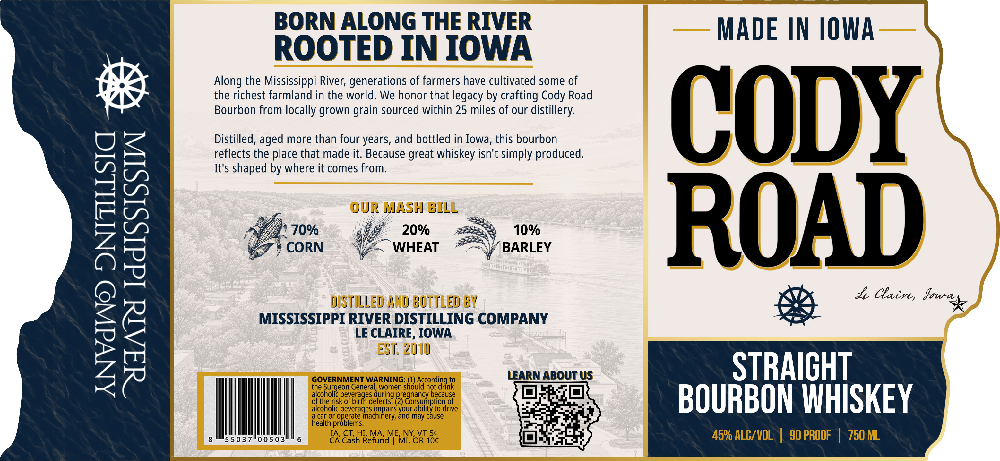

# TTB COLA Label Images - TTBID 26307001000884

**Brand Name:** CODY ROAD

**Issue Date:** 11/09/2026

**Origin Code:** 20

**Product Class/Type:** 101

**Source:** [TTB Public COLA Registry](https://ttbonline.gov/colasonline/viewColaDetails.do?action=publicFormDisplay&ttbid=26307001000884)

## Label Images

### Label 1

## Extracted Label Text

*Text extracted via OCR - may contain errors*

**Detected Proof:** 140

### Label 1

BORN ALONG THE RIVER
MADE IN IOWA
ROOTED IN IOWA
Along the Mississippi River; generations of farmers have cultivated some of
the richest farmland in the world. We honor that legacy by crafting Cody Road
Bourbon from locally grown
sourced within 25 miles of our distillery:
CODY
Distilled, aged more than four years, and bottled in Iowa, this bourbon
reflects the place that made it: Because great whiskey isn't simply produced.
It's shaped by where it comes from:
Fi
70%
our MA2OYHILL
10%
ROAD
CORN
WHEAT
BARLEY
Ie Clacre; Jowan
DISTILLED AND BOTTLED By
MISSISSIPPI RIVER DISTILLING COMPANY
23
LE CEAIRE IOWA
GOVERNMENT WARNING:
to
LEARN ABOUT US
STRAICHT
the Surgeon General, women
Shouaccoediagnte
not
afcoleolist
beyeragea
~defects;
Bregorasecnpeoac
beoauoe
BOURBON WHISKEY
alcoholic beverages impairs
aod mayrcausedrive
healtf
operate machinery;
may cause
problems.
IA, CT HI;MA, ME NY VT Sc
45% ALC/VOL
90 PROOF
750 ML
55037"00503
6
CA Cash Refund
MI; OR 10c
grain
during
Or
