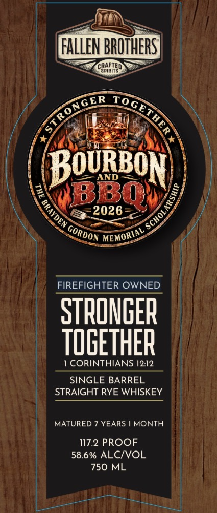
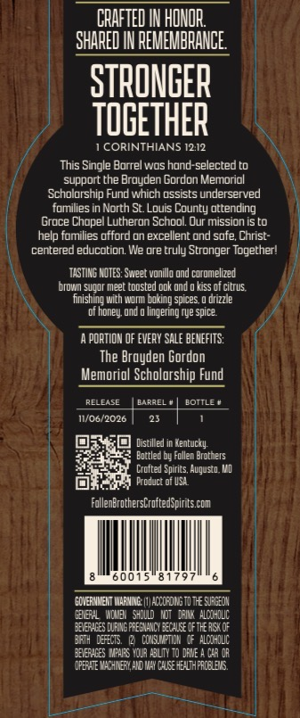
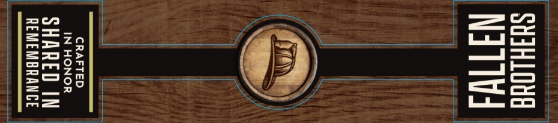

# TTB COLA Label Images - TTBID 26308001000114

**Brand Name:** FALLEN BROTHERS CRAFTED SPIRITS

**Fanciful Name:** STRONGER TOGETHER 
SINGLE BARREL 
STRAIGHT RYE WHISKEY

**Issue Date:** 11/09/2026

**Origin Code:** 29

**Product Class/Type:** 102

**Source:** [TTB Public COLA Registry](https://ttbonline.gov/colasonline/viewColaDetails.do?action=publicFormDisplay&ttbid=26308001000114)

## Label Images

### Label 1

### Label 2

### Label 3

## Extracted Label Text

*Text extracted via OCR - may contain errors*

**Detected Proof:** 117.2
**Detected Age:** 7 Years

### Label 1

FALLEN BROTHERS]
CRPEHED
BouRBON)
AND
9
BBQ
2026
FIREFIGHTER OWNED
STRONGER
TOGETHER
CORINTHIANS 12.12
SINGLE BARREL
STRAIGHT RYE WHISKEY
MATURED 7 YEARS
MONTH
117.2 PROOF
58.6% ALCIVOL
750 ML
STRONGER
TOGETHER
)
1
GORDON
MEMORIAL

### Label 2

CHAFTED IN HONOR
SHARED IN REMEMBRANGE
STRONGER
TOGETHER
1 CORINTHIANS 12.12
This Single Borrel wos hond-selected to
support the Broyden Gordon Memoriol
Scholorship Fund which ossistS underserved
fomilies in North St  Louis County ottending
Groce Chopel Lutheron School Our mission IS o
help fomilies ufford on excellent ond sufe; Christ-
centered educotion We ore truly Stronger Togetherl
TASTIRG MOTES: Sueet 5
ond coromelized
bfowIn Suq06 meet todsted ddk Ond @ kiss oT ciefus.
fnishing
INoIL boking spices
drizzle
lingering tye spice
PORTIDN OF EvERy SaLE BENEFLTS:
The Broyden Gordon
Memoriol Scholorship Fund
RELEASE
BarrEI
BOTTLE +
11/06/2026
Distilled
entucky
Enttled by Follen Broehets
Crofted Sperics, Alqustd, WI
Frcduct of U5A
FollenErothersCrofeedspir_es cCM
6001
ECHERMNEMT WarIG
rCCCFDUSTD TE SJrEUN
DI64L
Hchbe
SHDUD   MjT = DhUR   ALODhOLC
32eeX6ES DURUNG freS AYCY 3LkUcE Dfthe REXOF
3FTH   DFECTS
CCHSUPTIDL ^ df = ALODhDLIC
32*X6ES MPHRS HoR A3LIY T0 DhlE
C43 DR
dpEE WACHITLAD
C4lce elthfrCeLDS
vonillo C
henel

### Label 3

Se

SHIHLOUE
NIT

CRAFTED
IN HONOR

SHARED IN
REMEMBRANCE
