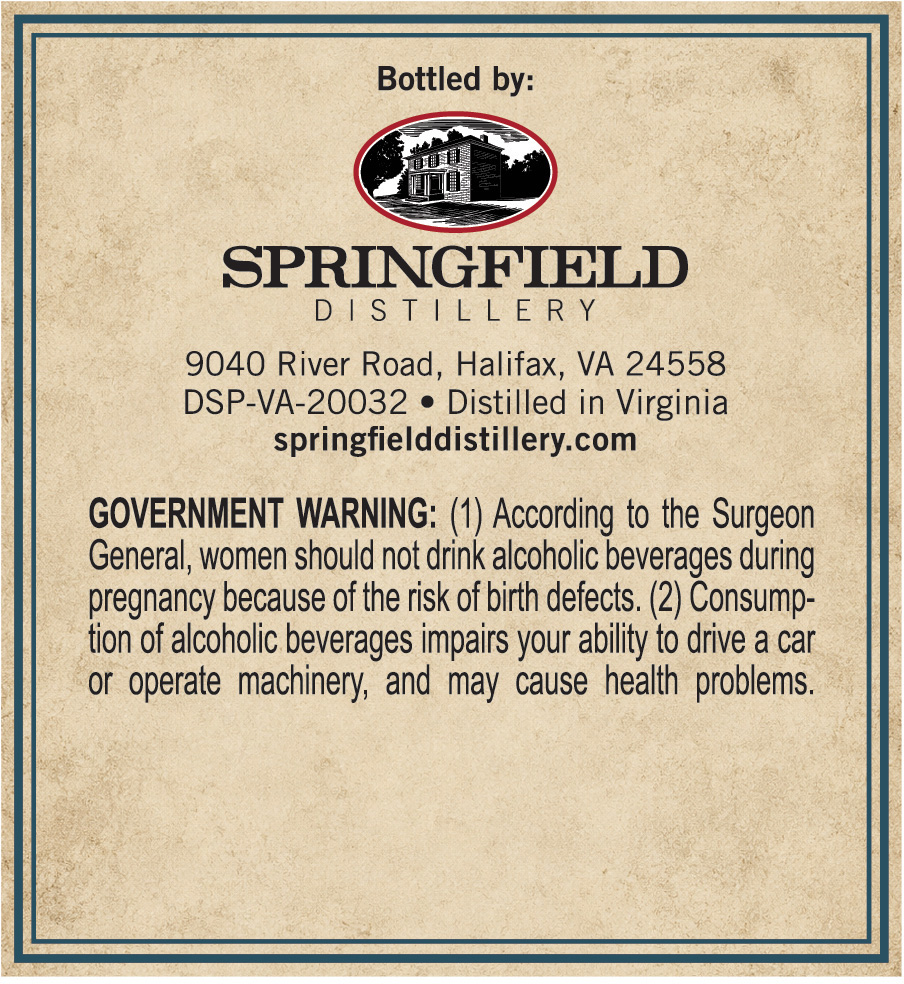
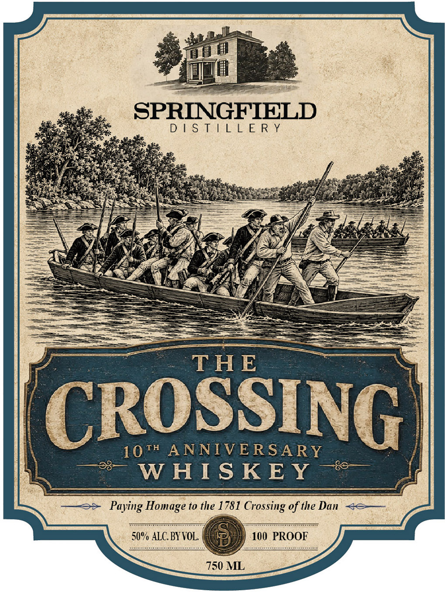

# TTB COLA Label Images - TTBID 26308001000115

**Brand Name:** THE CROSSING

**Fanciful Name:** 10TH ANNIVERSARY WHISKEY

**Issue Date:** 11/05/2026

**Origin Code:** 05

**Product Class/Type:** 140

**Source:** [TTB Public COLA Registry](https://ttbonline.gov/colasonline/viewColaDetails.do?action=publicFormDisplay&ttbid=26308001000115)

## Label Images

### Back Label

### Front Label

## Extracted Label Text

*Text extracted via OCR - may contain errors*

**Detected Proof:** 100

### Back Label

Bottled by

SPRINGFIELD

Dales [e eLS ERY.

9040 River Road, Halifax, VA 24558

DSP-VA-20032 e Distilled in Virginia

springfielddistillery.com

GOVERNMENT WARNING: (1) According to the Surgeon

General, women should not drink alcoholic beverages during

pregnancy because of the risk of birth defects. (2) Consump

tion of alcoholic beverages impairs your ability to drive a car

or operate machinery, and may cause health problems

### Front Label

3 ie
$e

Beas DISTILLERY
- sats pee. « ‘
f OATS en / de
PERE NEN iscsi ES
—— Se Swe ee! | SA MC Y Sael WAartt oette
— ig, NUS ROS oO
= Ate Me
/ \
tee 3
\ 1077 ANNIVERSARY j|
qe WHISKEY As

a

— => Paying Homage to the 1781 Crossing of the Dan <S—
50% ALC. BY VOL. (G@ieigy) 100 PROOF
750 ML
