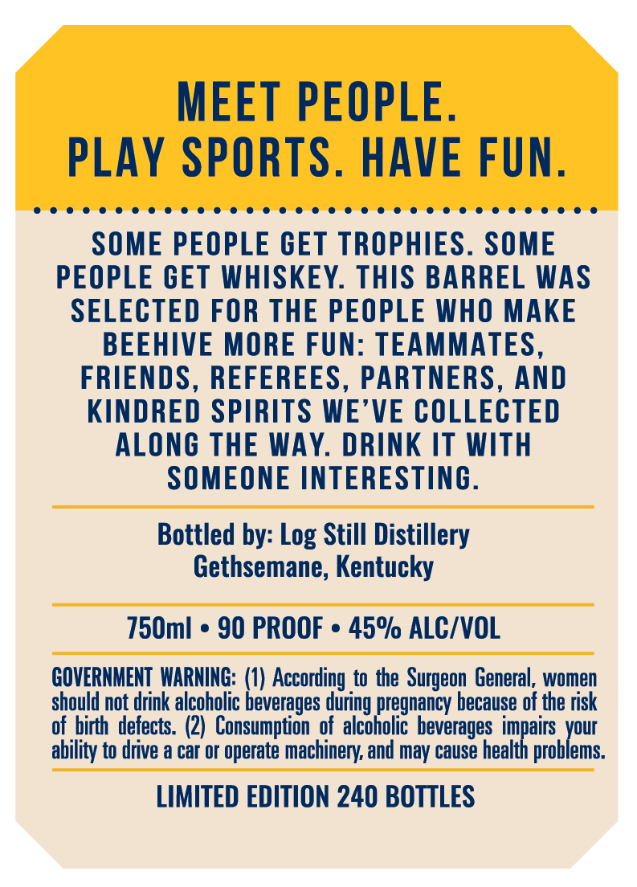
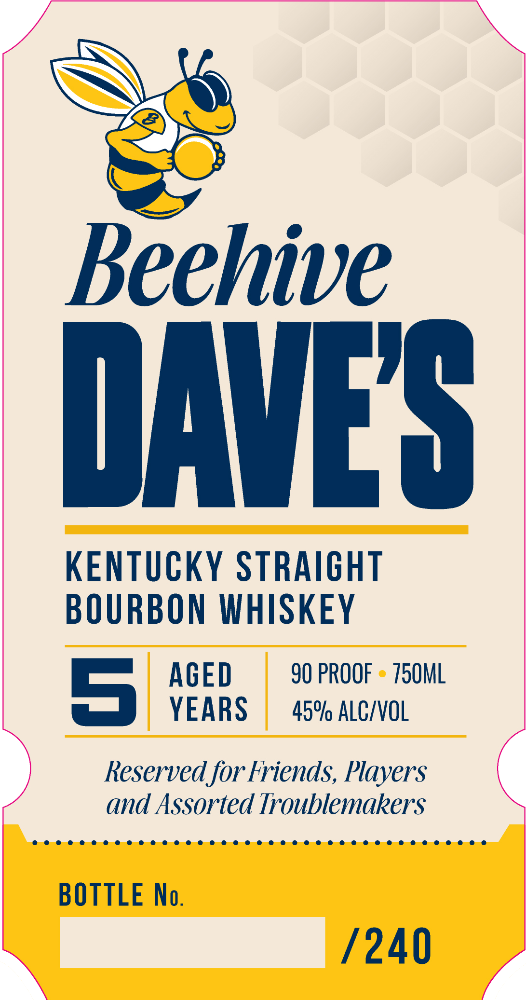
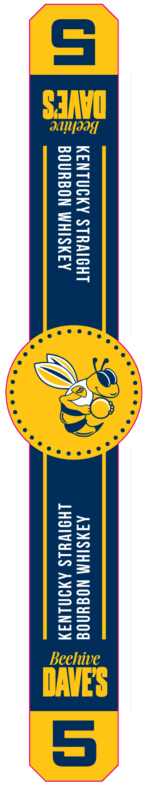

# TTB COLA Label Images - TTBID 26308001000172

**Brand Name:** BEEHIVE DAVE'S

**Issue Date:** 11/17/2026

**Origin Code:** 22

**Product Class/Type:** 101

**Source:** [TTB Public COLA Registry](https://ttbonline.gov/colasonline/viewColaDetails.do?action=publicFormDisplay&ttbid=26308001000172)

## Label Images

### Back Label

### Front Label

### Label 2

## Extracted Label Text

*Text extracted via OCR - may contain errors*

**Detected Proof:** 90

### Back Label

MEET PEOPLE

PLAY SPORTS. HAVE FUN

weer rcccccccccccccccccceccocececccoce

SOME PEOPLE GET TROPHIES. SOME

PEOPLE GET WHISKEY. THIS BARREL WAS

SELECTED FOR THE PEOPLE WHO MAKE

BEEHIVE MORE FUN: TEAMMATES

FRIENDS, REFEREES, PARTNERS, AND

KINDRED SPIRITS WE’VE COLLECTED

ALONG THE WAY. DRINK IT WITH

SOMEONE INTERESTING

Bottled by: Log Still Distillery

Gethsemane, Kentucky

750ml + 90 PROOF * 45% ALC/VOL

GOVERNMENT WARNING: (1) According to the Surgeon General, women

of bi

should not drink alcoholic beverages during pregnancy hecause of the risk

airs

our

ability to drive a car or operate machinery, and may cause healt

defects. (2) Consumption of alcoholic beverages im

i

problems.

I

LIMITED EDITION 240 BOTTLES

### Front Label

2)

%

beeh

IVE

DAVE

KENTUCKY STRAIGHT

BOURBON WHISKEY

AGED

90 PROOF » 750ML

YEARS

45% ALC/VOL

Reserved for Friends, Players

eoeoeerecececeoeceoeeoeeo eee eoeeoeeoe ee ee eee eeeeeeee

and Assorted Troublemakers

BOTTLE No.

/240

### Label 2

KENTUCKY STRAIGHT : AJXSIHM NOSYNO
BOURBON WHISKEY LHOIWYLS AMONLNAY

Beehive
DAVES

SJAVO
ayaa
