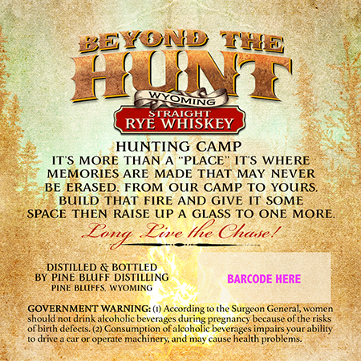
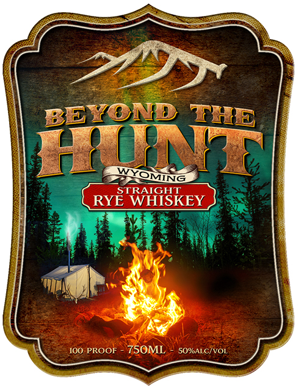

# TTB COLA Label Images - TTBID 26308001000222

**Brand Name:** BEYOND THE HUNT

**Fanciful Name:** PINE BLUFFS DISTILLING

**Issue Date:** 11/13/2026

**Origin Code:** 49

**Product Class/Type:** 102

**Source:** [TTB Public COLA Registry](https://ttbonline.gov/colasonline/viewColaDetails.do?action=publicFormDisplay&ttbid=26308001000222)

## Label Images

### Back Label

### Label 1

## Extracted Label Text

*Text extracted via OCR - may contain errors*

### Back Label

EEYONb "E;
KT
RYE
EWHiSKEY
HUNTING CAMP
ITS MORE THAN A "PLACE" ITS WHERE
MEMORIES ARE MADE THAT MAY NEVER
BE ERASED
FROM OUR CAMP TO YOURS
BUILD
THAT
FIRE AND GIVE
IT SOME
SPACE THEN RAISE UP A GLASS TO ONE MORE
Long
Live Ile Chase
DISTILLED & BOTTLED
BY PINE BLUFF DISTILLING
BARCODE HERE
PINE BLUFFS: Wyoming
GOVERNMENT WARNING: () According
he
Surgeon General; women
should not drink alcoholic beverages during pregnancy because ofthe risks
of birth defeets: (2) Consumption of alcoholic beverages impairs your ability
drive
Gror
machinery and may cause health problems:
FYOMNG
"penic

### Label 1

BEYOND THE
HINNT
STRAIGHT
RYE WHISKEY
IOO PROOF
7SOML
SO%ALCIVOL
OMNG
