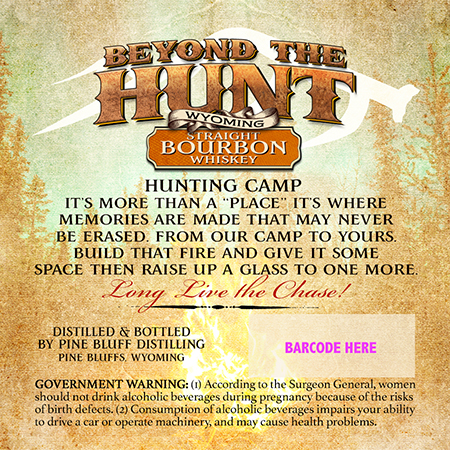
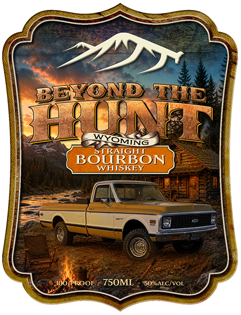

# TTB COLA Label Images - TTBID 26308001000226

**Brand Name:** BEYOND THE HUNT

**Fanciful Name:** PINE BLUFFS DISTILLING

**Issue Date:** 11/13/2026

**Origin Code:** 49

**Product Class/Type:** 101

**Source:** [TTB Public COLA Registry](https://ttbonline.gov/colasonline/viewColaDetails.do?action=publicFormDisplay&ttbid=26308001000226)

## Label Images

### Back Label

### Label 1

## Extracted Label Text

*Text extracted via OCR - may contain errors*

### Back Label

BEYONR
TD
FWV
BOURBON
WHISKEY
HUNTING CAMP
IT'S MORE THAN A "PLACE
ITS WHERE
MEMORIES
ARE MADE THAT MAY NEVER
BE ERASED. FROM OUR CAMP TO YOURS.
BUILD THAT FIRE AND GIVE
IT SOME
SPACE
THEN RAISE UP A GLASS TO ONE MORE
Long
Lie Ile Chasse !
DISTILLED & BOTTLED
BY PINE BLUFF DISTILLING
BARCODE HERE
PINE BLUFFS WYOMING
GOVERNMENT WARNING: (1) According
the Surgcon General;
Huen
should
drink
Icoholicbeverages
pregnancy because ofthe risks
ofbirth defects: (2) Consumption
alcotiolie
Exverages impairs your ability
drive
cror
operate machinery; and may cause health problems;
YYOMING

### Label 1

7
BEYOND THE
HONN
STRAIGHT
BOURBON
WHISKEY
J06PROOF - 750ML
SO%ALCIVOL
WYOMNG
