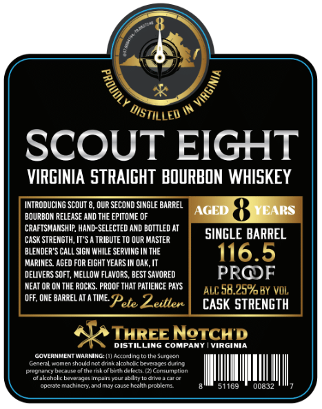
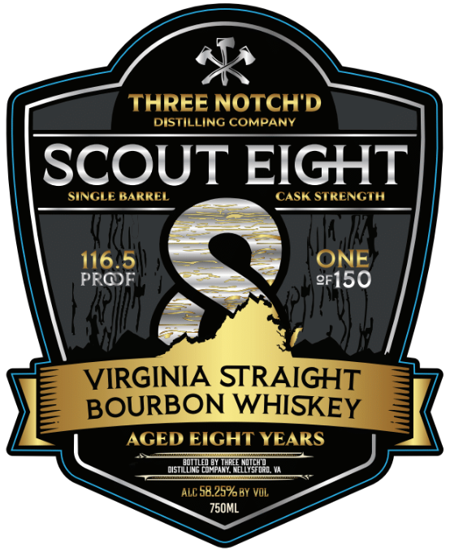

# TTB COLA Label Images - TTBID 26308001000325

**Brand Name:** THREE NOTCH'D DISTILLING COMPANY

**Fanciful Name:** SCOUT EIGHT

**Issue Date:** 11/10/2026

**Origin Code:** 05

**Product Class/Type:** 101

**Source:** [TTB Public COLA Registry](https://ttbonline.gov/colasonline/viewColaDetails.do?action=publicFormDisplay&ttbid=26308001000325)

## Label Images

### Back Label

### Front Label

## Extracted Label Text

*Text extracted via OCR - may contain errors*

### Back Label

SCOUT EIGHT
VIRGINIA STRAIGHT  BOURBON WHISKEY
INTRODUCING ScOUT
OUR SECOND SINGLE BARREL
AGLD
VCARS
BOURBON RELEASE AND THE EPITOME OF
CRAFTSMANSHIP: HAND-SELECTEd AND boTtled At
CaSk STRENGTH, IT "'5
TRIBUTE TO OUR MASTER
SINGLE BARREL
BLEMDER'
CALL SGN WHILE SERVING IN THE
116.5
MARINES. AGED FOR EIGHT YEARS IN OAK, IT
DELIVERS SOFT, MELLOW FLAVORS , BEST SAVORED
PROF
NEAT OR ON THE ROCKS: PROOF THAT PATIENCE PAYS
ALC 58.25% BY VOL
OFF, ONE BARREL AT
TIME
Pete Zeitlen
CASK STRENGTH
THREENeTCHD
DistN
Compant
Wanna
GOVERHMAENT WAANINGWacardingt0tle Surueo
General #omen shouldoot drikakcolo
Deveades cunno
pregnancy beraurs ofthemtkofhatho ft
Kontumotion
~dakoholic beverage,
ImtDailyejum
audty
Qltauclar
Operale nucnentand marcaueteaunkoble
51169
00832
0
OisTILLED

### Front Label

THREE NOTCHD
DISTILLING COMPANY
SCOUT EIGHT
SINGLE BARREL
CASK STRENGTH
116.5
ONE)
PROF
2F150
VIRGINIA STRAIGHT
BOURBON WHISKEY
AGED EIGHT YEARS
disiuikammk
ALC 58,25%BY VOL
750mL
