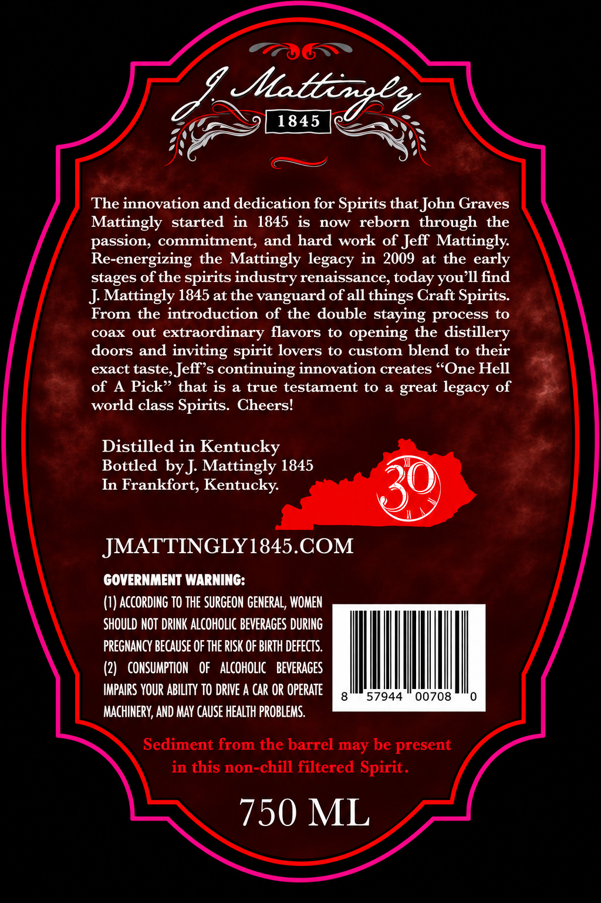
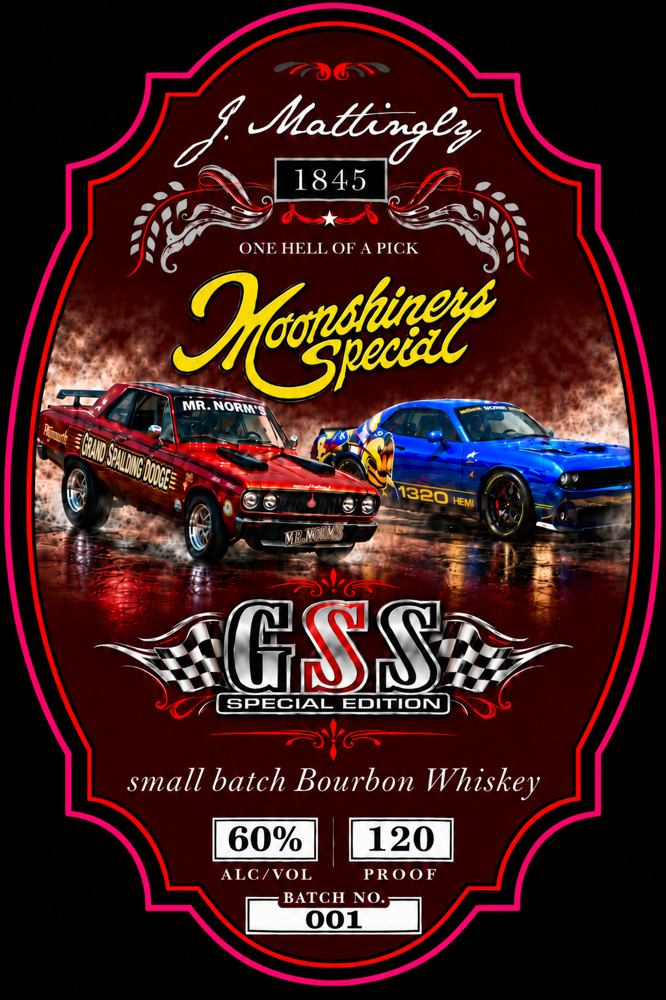

# TTB COLA Label Images - TTBID 26308001000404

**Brand Name:** J. MATTINGLY 1845

**Fanciful Name:** MOONSHINERS SPECIAL

**Issue Date:** 11/12/2026

**Origin Code:** 22

**Product Class/Type:** 140

**Source:** [TTB Public COLA Registry](https://ttbonline.gov/colasonline/viewColaDetails.do?action=publicFormDisplay&ttbid=26308001000404)

## Label Images

### Back Label

### Label 1

## Extracted Label Text

*Text extracted via OCR - may contain errors*

**Detected Proof:** 120

### Back Label

The innovation and dedication for Spirits that John Graves
Mattingly started in 1845 is now reborn through the
passion, commitment, and hard work of Jeff Mattingly.
Re-energizing the Mattingly legacy in 2009 at the early
stages of the spirits industry renaissance, today you’ll find
J. Mattingly 1845 at the vanguard of all things Craft Spirits.
From the introduction of the double staying process to
coax out extraordinary flavors to opening the distillery
doors and inviting spirit lovers to custom blend to their
exact taste, Jeff’s continuing innovation creates “One Hell

of A Pick” that is a true testament to a great legacy of

world class Spirits. Cheers!

Distilled in Kentucky
Bottled by J. Mattingly 1845
In Frankfort, Kentucky.

JMATTINGLY1845.COM

GOVERNMENT WARNING:
(1) ACCORDING TO THE SURGEON GENERAL, WOMEN

SHOULD NOT DRINK ALCOHOLIC BEVERAGES DURING
PREGNANCY BECAUSE OF THE RIK OF BIRTH DEFECTS,
(2) CONSUMPTION OF ALCOHOLIC BEVERAGES
IMPAIRS YOUR ABILITY TO DRIVE A CAR OR OPERATE PALM oy MLA

MACHINERY, AND MAY CAUSE HEALTH PROBLEMS.

Sediment from the barrel may be present
in this non-chill filtered Spirit.

750 ML

### Label 1

Matbnge
1845
ONE HELL OF
A PICK
Ieggphinet
MR . NORM 8
Gbd
HEMi
MBaMoRMS
GSS
SPECIAL
EDITION
small batch Bourbon
Whiskey
60%
120
ALC /VOL
PROOF
BATCH NO.
001
Hctaittni
Rwgh
)QL
Alue e
1320
