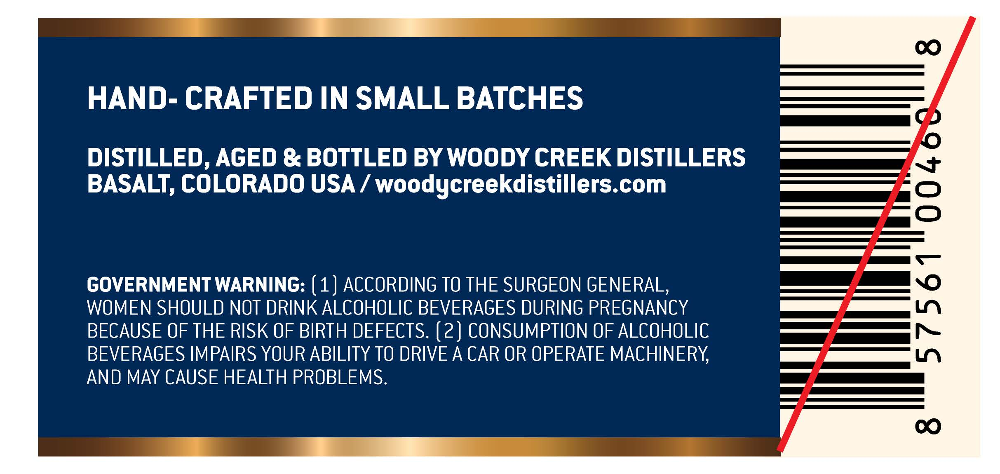
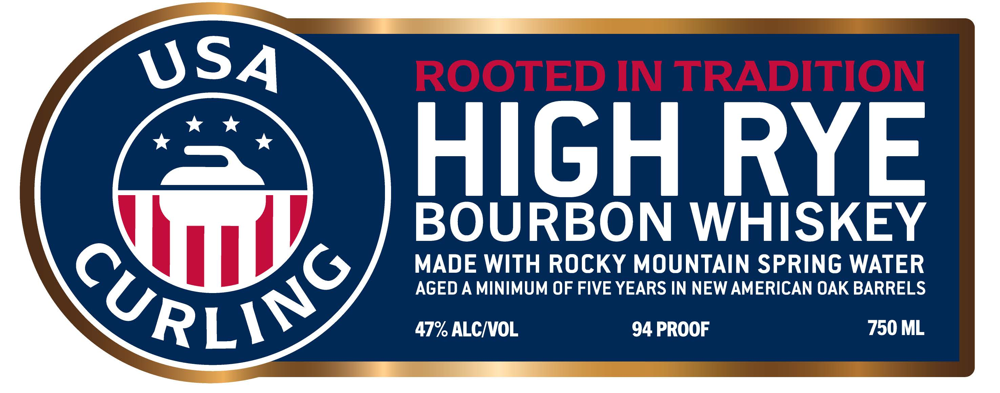
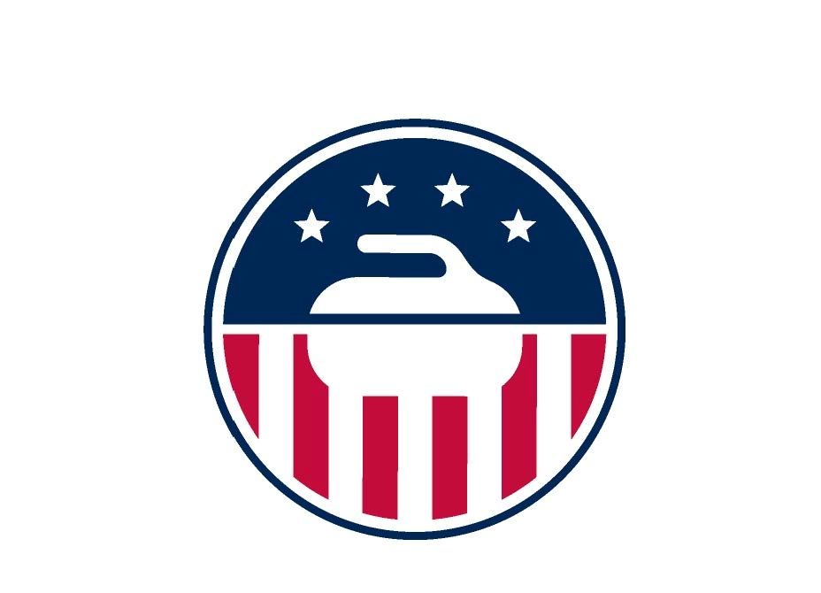
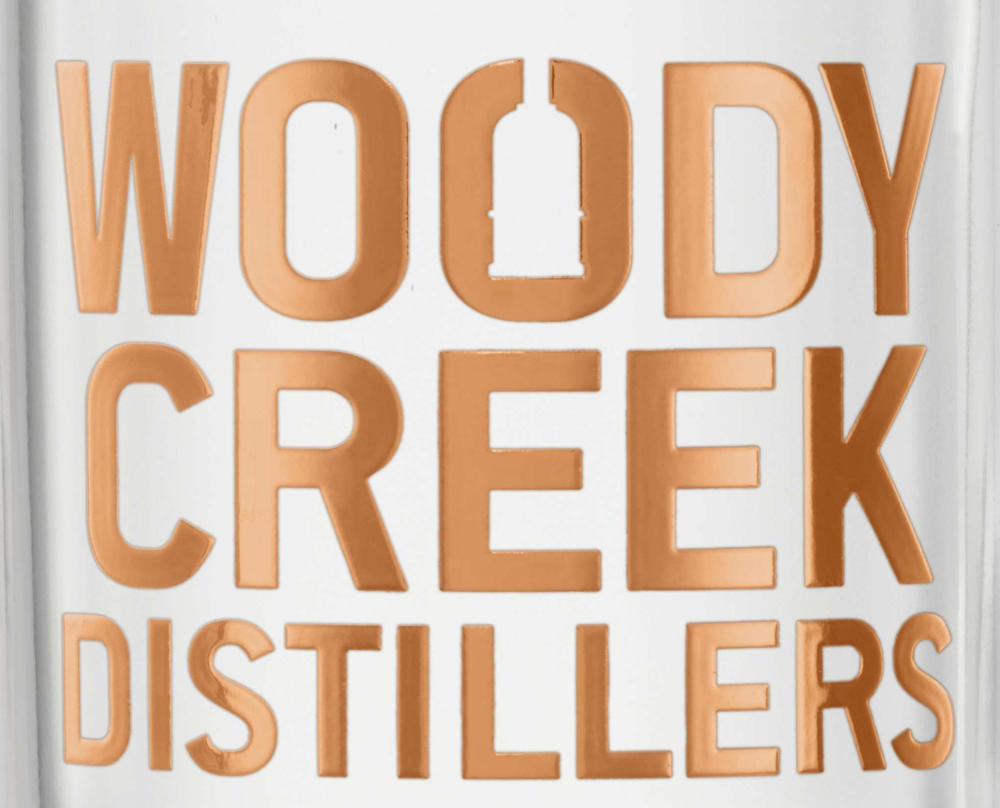

# TTB COLA Label Images - TTBID 26308001000459

**Brand Name:** WOODY CREEK DISTILLERS

**Fanciful Name:** USA CURLING

**Issue Date:** 11/09/2026

**Origin Code:** 13

**Product Class/Type:** 141

**Source:** [TTB Public COLA Registry](https://ttbonline.gov/colasonline/viewColaDetails.do?action=publicFormDisplay&ttbid=26308001000459)

## Label Images

### Back Label

### Front Label

### Label 3

### Label 4

## Extracted Label Text

*Text extracted via OCR - may contain errors*

*2 image(s) excluded: text did not meet readability threshold*

**Detected Proof:** 94

### Back Label

0
HAND- CRAFTED IN SMALL BATCHES
DISTILLED, AGED & BOTTLED BY WOODY CREEK DISTILLERS
BASALT, COLORADO USA / woodycreekdistillers.com
8
(
GOVERNMENT WARNING: ( 1 ) ACCORDING TO THE SURGEON GENERAL,
WOMEN SHOULD NOT DRINK ALCOHOLIC BEVERAGES DURING PREGNANCY
;
BECAUSE OF THE RISK OF BIRTH DEFECTS. (2) CONSUMPTION OF ALCOHOLIC
BEVERAGES IMPAIRS YOUR ABILITY TO DRIVEA CAR OR OPERATE MACHINERY
AND MAY CAUSE HEALTH PROBLEMS.
0

### Front Label

USA
ROOTED IN TRADITION
HIGH RYE
BOURBON
WHISKEY
MADE WITH ROCKY MOUNTAIN SPRING WATER
AGED A MINIMUM OF FIVE YEARS IN NEW AMERICAN OAK BARRELS
CeRLLG
47% ALCIVOL
94 PROOF
750 ML
