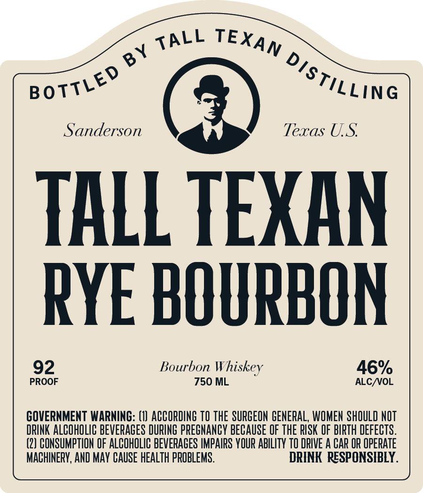

# TTB COLA Label Images - TTBID 26308001000464

**Brand Name:** TALL TEXAN RYE BOURBON

**Issue Date:** 11/10/2026

**Origin Code:** 44

**Product Class/Type:** 141

**Source:** [TTB Public COLA Registry](https://ttbonline.gov/colasonline/viewColaDetails.do?action=publicFormDisplay&ttbid=26308001000464)

## Label Images

### Label 1

## Extracted Label Text

*Text extracted via OCR - may contain errors*

**Detected Proof:** 92

### Label 1

Sanderson
Texas US
TALL TEXAN
RYE BOURBON
92
Bourbon
46%
PROOF
750 ML
ALCNOL
GOVERNMENT WARNING: (I) ACCORDING TO THE SURGEON  GENERAL, WOMEN SHOULD NOT
DRINK ALCOHOLIC beveRACES DURING PPEGNANCY BECAuSE OF THE RISK OF BIPTH defects.
(2) CONSUMPTION OF ALCOHOLIC BEVERAGES IMPAIPS YOUR AbIlITy TO DRIVE A CAR OR OpepATE
MACHINERY, AND MAY CAuSe HEALTH PROBLEMS .
DRINK  RESPONSIBLY .
TALL
TEXAN
BY
distiLLing
BOTTLED
Whiskey
