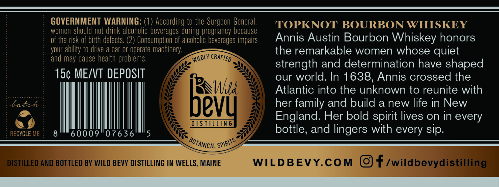
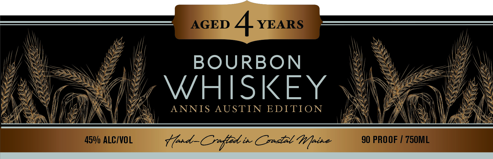

# TTB COLA Label Images - TTBID 26308001000466

**Brand Name:** TOPKNOT

**Fanciful Name:** ANNIS AUSTIN EDITION

**Issue Date:** 11/11/2026

**Origin Code:** 24

**Product Class/Type:** 141

**Source:** [TTB Public COLA Registry](https://ttbonline.gov/colasonline/viewColaDetails.do?action=publicFormDisplay&ttbid=26308001000466)

## Label Images

### Back Label

### Front Label

### Label 1

### Label 3

## Extracted Label Text

*Text extracted via OCR - may contain errors*

*1 image(s) excluded: text did not meet readability threshold*

**Detected Proof:** 90
**Detected Age:** 4 Years

### Back Label

GOVERNMENT WARNING: (1) According to the Surgeon General;
TOPKNOT BOURBON WHISKEY
women should not drink alcoholic beverages during pregnancy because
of the risk of birth defects: (2) Consumption of alcoholic beverages impairs
Annis Austin Bourbon Whiskey honors
your ability to drive & car or operate machinery;
the remarkable women whose
and may cause health problems.
strength and determination have shaped
15c MEZVT DEPOSIT
our world. In
1638, Annis crossed the
Bkua
Atlantic into the unknown to reunite with
Latch
bevy
her family and build a new life in New
England: Her bold spirit lives on in every
D STIING
RECYCLE ME
60009
07636
bottle, and lingers with every sip.
DISTILLED AND BOTTLED BY WILD BEVY DISTILLING IN WELLS, MAINE
WILDBEVY.COM
f/wildbevydistilling
quiet
'Wildlv
CRAFTED
'SPIRITS ~
'Botanical '

### Front Label

AGED
4
YEARS
BOURBON
WHISKEY
ANNIS
AUSTIN
EDITION
459/ ALCIVOL
Yd-Crafbdi Castl
90 PROOF
750ML
Mlaine

### Label 3

WILD BEVY DISTILLING

WILD BEVY DISTILLING

WILD BEVY DISTILLING
