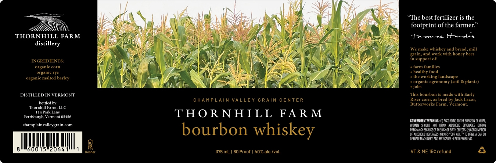

# TTB COLA Label Images - TTBID 26308001000592

**Brand Name:** THORNHILL FARM

**Issue Date:** 11/12/2026

**Origin Code:** 46

**Product Class/Type:** 141

**Source:** [TTB Public COLA Registry](https://ttbonline.gov/colasonline/viewColaDetails.do?action=publicFormDisplay&ttbid=26308001000592)

## Label Images

### Label 1

## Extracted Label Text

*Text extracted via OCR - may contain errors*

**Detected Proof:** 80

### Label 1

"The best fertilizer is the
footprint of the farmer:
THORNHILL FARM
Tna4
1 AL
distillery
We make whiskey and bread, mill
and work with honey bees
INGREDIENTS:
support of:
organic
orn
farm families
Tye
healthy Tood
organic malted barley
the working
landscape
Organic #gronomy (soil & plants)
jobs
DISTILLED IN VERMONT
This bourbon
made with Farly
C HAMPLAIN VALLEY GRATN C ENTE R
Riser corf, #s bredby Jack Lazor,
bottledby
Butterworks Farm,
croni,
Thornhill Farm, LLC
FerrisburghP verthont 05456
THO RN HILL
FA RM
GOVEFDIMEMT WapMuG:
NOdAD HG TQ The surzchcRRL
champlainvalleygrain
COn
WCMEN   ShC lld   KoT   drl{  picuhDC eeveaXES  DIRNG
bourbon whiskey
Of ehohoc eeve4e  eskof MaroeUip {o danaSUubT or
OPEFATE VUCHINEFO, AaoMIYCIX health peobe
60015
206_
Koshci
9
376 mL
80 Proof | 40% alc Ivol.
VT & ME ISc refund
BFain,
Organic
Lane
