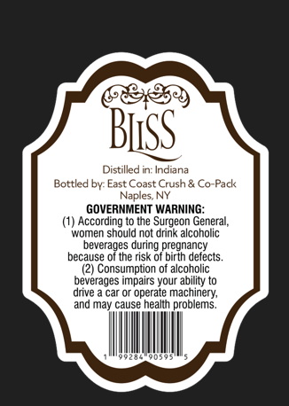
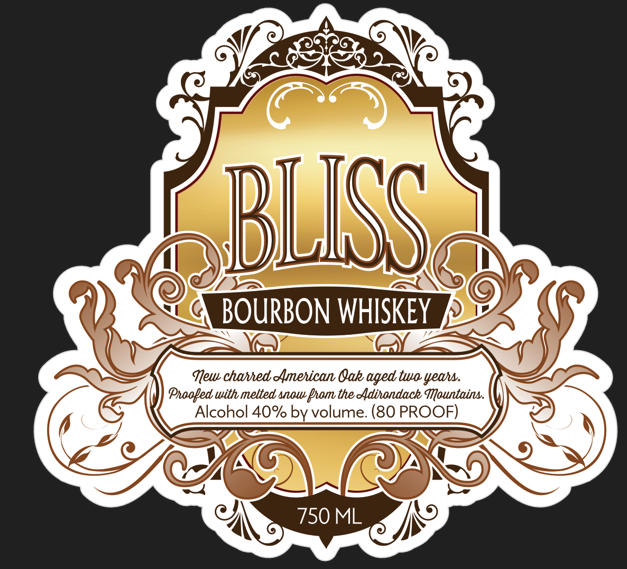

# TTB COLA Label Images - TTBID 26308001000622

**Brand Name:** BLISS

**Issue Date:** 11/17/2026

**Origin Code:** 02

**Product Class/Type:** 141

**Source:** [TTB Public COLA Registry](https://ttbonline.gov/colasonline/viewColaDetails.do?action=publicFormDisplay&ttbid=26308001000622)

## Label Images

### Back Label

### Front Label

## Extracted Label Text

*Text extracted via OCR - may contain errors*

**Detected Proof:** 60

### Back Label

Biss
Distilled in: Indiana
Bottled bY East Coast Crush
Co-Pack
Naples; NY
GOVERNMENT WARNING:
(1) According to the Surgeon General,
women should not drink alcoholic
beverages during pregnancy
because of the risk of birth defects
Consumption of alcoholic
beverages impairs your ability to
drve
car Or operate machinery;
and may cause health problems.

### Front Label

'BLISS
BOURBON WHISKEY
Tel chaved dmexican Oak aged twa yeau:
Pnooled with melted
4now
bom the cdinondack Tlountains.
Alcohol 40% by volume
30 PROOF)
750 ML
