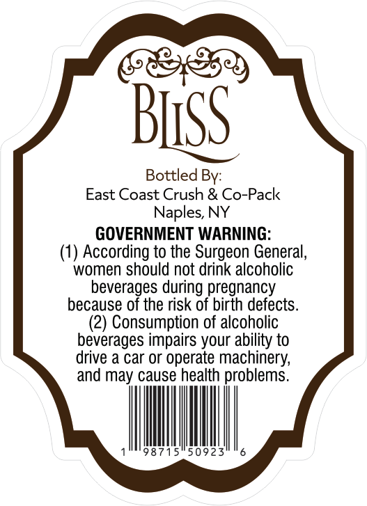
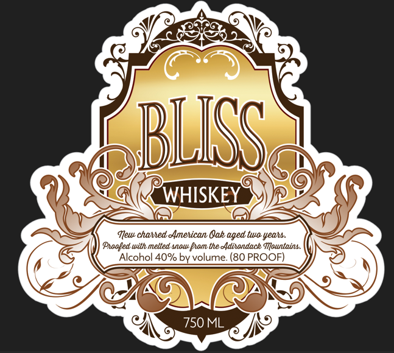

# TTB COLA Label Images - TTBID 26308001000648

**Brand Name:** BLISS

**Issue Date:** 11/17/2026

**Origin Code:** 02

**Product Class/Type:** 140

**Source:** [TTB Public COLA Registry](https://ttbonline.gov/colasonline/viewColaDetails.do?action=publicFormDisplay&ttbid=26308001000648)

## Label Images

### Back Label

### Front Label

## Extracted Label Text

*Text extracted via OCR - may contain errors*

### Back Label

bss

Bottled By:

East Coast Crush & Co-Pack

Naples, NY

GOVERNMENT WARNING:

(1) According to the Surgeon General

women should not drink alcoholic

beverages during pregnancy

because of the risk of birth defects

(2) Consumption of alcoholic

beverages impairs your ability to

drive a car or operate machinery,

and may cause health problems.

|

I

l

|

### Front Label

BLISS
WHISKEY
Tel chated dmenican Qak aged two
Phoofed with melted snow fom the dditondack @lountaius.
Alcohol 40% by volume
0 PROOF)
750 ML
veau.
