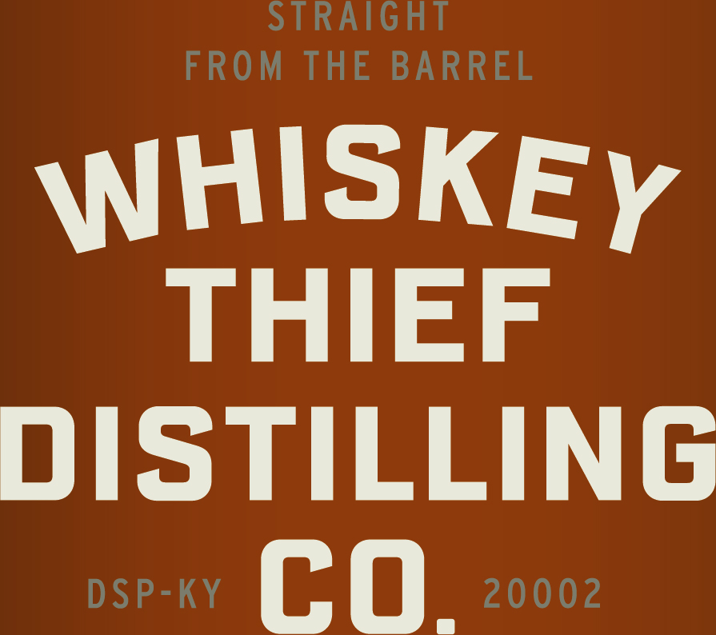
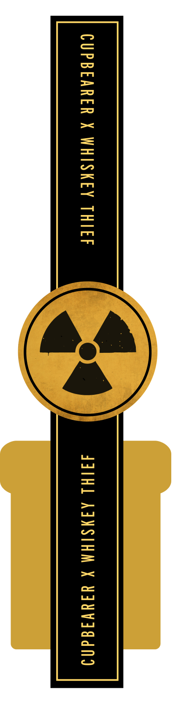
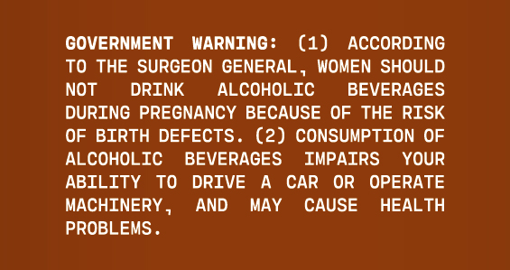
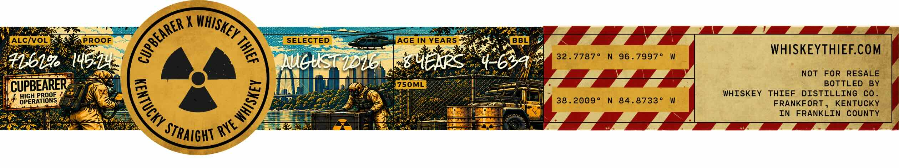

# TTB COLA Label Images - TTBID 26308001000654

**Brand Name:** WHISKEY THIEF DISTILLING CO.

**Fanciful Name:** CUPBEARER RYE

**Issue Date:** 11/13/2026

**Origin Code:** 22

**Product Class/Type:** 102

**Source:** [TTB Public COLA Registry](https://ttbonline.gov/colasonline/viewColaDetails.do?action=publicFormDisplay&ttbid=26308001000654)

## Label Images

### Front Label

### Label 2

### Label 3

### Label 4

## Extracted Label Text

*Text extracted via OCR - may contain errors*

### Front Label

STRAIGHT
FROM
THE
BARREL
WHISKEY
THIEF
DiSTILLING
DSP-KY
cCo
20002

### Label 2

CUPBEARER X WHISKEY THIEF JHIHL AINSTHM X YANVIadNI

### Label 3

GOVERNMENT
WARNING :
(1)
ACCORDING
To THE SURGEON GENERAL ,
WOMEN SHOULD
NOT
DRINK
ALCOHOLIC
BEVERAGES
DURING PREGNANCY BECAUSE OF
THE RISK
OF BIRTH DEFECTS. (2) CONSUMPTION OF
ALCOHOLIC
BEVERAGES
IMPAIRS
YOUR
ABILITY
To
DRIVE
CAR
OR
OPERATE
MACHINERY
AND
MAY
CAUSE
HEALTH
PROBLEMS _

### Label 4

X
ALCIvOL
PROoF
SELECTED
AGE IN YEARS
BBLI
WHISKEYTHIEFCOM
77870
N
96.7997 0
W
{lblg I45144
AGKT b
{uEkps
4-694
Not
FOR
RESALE
CUPBEARER
F50ML
BOTTLED
BY
high
WHISKEY
THIEF
DISTILLING
Co
8FGkR59o5
38. 2009 %
N
84.87339
W
FRANKFORT
KENTUCKY
In
FRANKLIN county
WhISkey
CUPBEARER _
0
32 .
(
1
RYE
Straight
