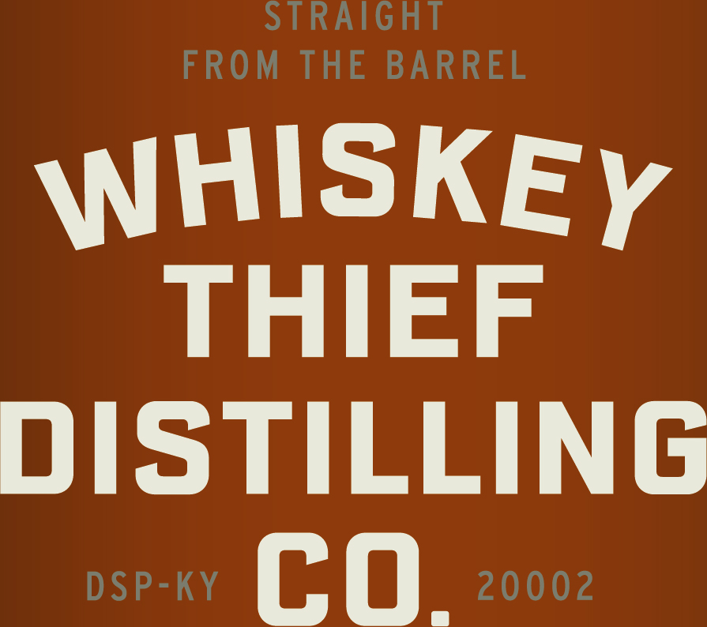
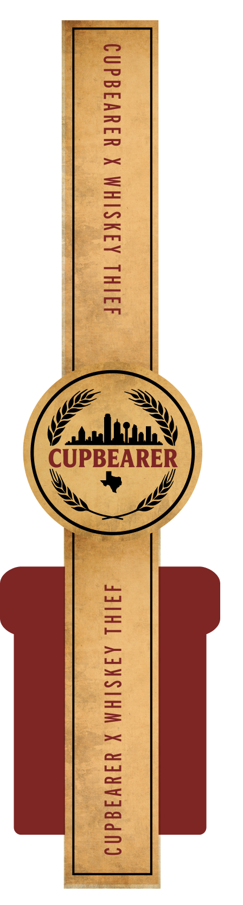
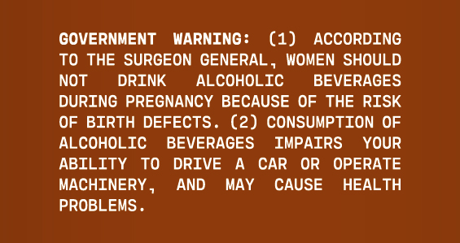
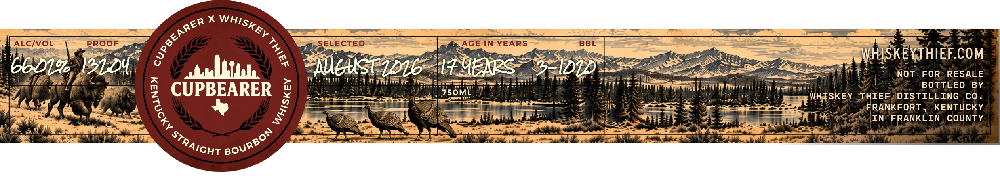

# TTB COLA Label Images - TTBID 26308001000655

**Brand Name:** WHISKEY THIEF DISTILLING CO.

**Fanciful Name:** CUPBEARER BOURBON

**Issue Date:** 11/13/2026

**Origin Code:** 22

**Product Class/Type:** 101

**Source:** [TTB Public COLA Registry](https://ttbonline.gov/colasonline/viewColaDetails.do?action=publicFormDisplay&ttbid=26308001000655)

## Label Images

### Front Label

### Label 2

### Label 3

### Label 4

## Extracted Label Text

*Text extracted via OCR - may contain errors*

### Front Label

STRAIGHT
FROM
THE
BARREL
WHISKEY
THIEF
DiSTILLING
DSP-KY
cCo
20002

### Label 2

‘| CUPBEARER X WHISKEY THIEF

Fults

CUPBEARER

### Label 3

GOVERNMENT
WARNING :
(1)
ACCORDING
To THE SURGEON GENERAL ,
WOMEN SHOULD
NOT
DRINK
ALCOHOLIC
BEVERAGES
DURING PREGNANCY BECAUSE OF
THE RISK
OF BIRTH DEFECTS. (2) CONSUMPTION OF
ALCOHOLIC
BEVERAGES
IMPAIRS
YOUR
ABILITY
To
DRIVE
CAR
OR
OPERATE
MACHINERY
AND
MAY
CAUSE
HEALTH
PROBLEMS _

### Label 4

X
ALcIVOL
PROOF
SELECTED
AGE IN YEARS
BBL
WHISKEYTHIEF.COM
66814 12104
AUGtKT116
I4 HE4PS
2-[D1D
NOt
FOR
RESALE
CUPBEARER
750ML
BOTTLED
BY
WHISKEY
THIEF
DISTILLING
Co
FRANKFORT
KENTUCKY
Tm
In
FRANKLIN
county
WAISKEY
CUPBEARER
1
Mtbh
(
1
BOURBON
STRAL
ICHT
