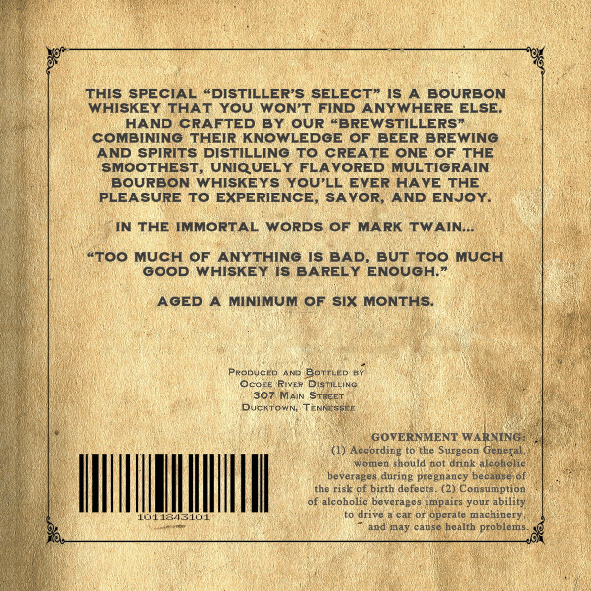
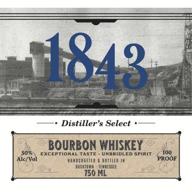

# TTB COLA Label Images - TTBID 26308001000721

**Brand Name:** 1843

**Fanciful Name:** DISTILLERS SELECT

**Issue Date:** 11/24/2026

**Origin Code:** 43

**Product Class/Type:** 141

**Source:** [TTB Public COLA Registry](https://ttbonline.gov/colasonline/viewColaDetails.do?action=publicFormDisplay&ttbid=26308001000721)

## Label Images

### Back Label

### Front Label

## Extracted Label Text

*Text extracted via OCR - may contain errors*

**Detected Proof:** 150

### Back Label

THIS SPECIAL
"DISTILLER'S SELECT" IS
A
BOURBON
WHISKEY
THAT YOU
WONT
FIND
ANYWHERE ELSE:
HAND CRAFTED
BY OUR "BREWSTILLERS"
COMBINING THEIR KNOWLEDGE
OF
BEER BREWING
AND SPIRITS DISTILLING
To
CREATE
ONE
OF
THE
SMOOTHEST, UNIQUELY FLA VORED
MULTIGRAIN
BOURBON WHISKEYS YOU'LL EVER
HAVE
THE
PLEASURE TO EXPERIENCE, SAVOR,
AND ENJOY.
IN THE IMMORTAL
WORDS
OF
MARK
TWAIN:..
SToo
MUCH
OF
ANYTHING IS BAD, BUT Too
MUCH
GOOD
WHISKEY IS
BARELY ENOUGH"
AGED
A
MINIMUM OF
SIX MONTHS:
PRODUcED
AND BoTTLED
BY
OcoEE RIVER DISTILLING
307
MAIN STREET
DUcKTOWN; TENNESSEE
GOVERNMENT WARNING :
(1) According to the Surgeon General;
women should not drink alcoholic
beverages during pregnancy because- of
the risk of birth defects
(2) Consumption
of alcoholic beverages impairs your ability
1Oll3/3101
to drive a car
OI
operate machinery
and may cause health problems

### Front Label

184o
Distiller' $ Select
BOURBON WHISKEY
EXCEPTIONAL TASTE
UARRIDLED APIRAT
Alc/Vol
Hanamamnm
BTL
PROOF
150 ML
