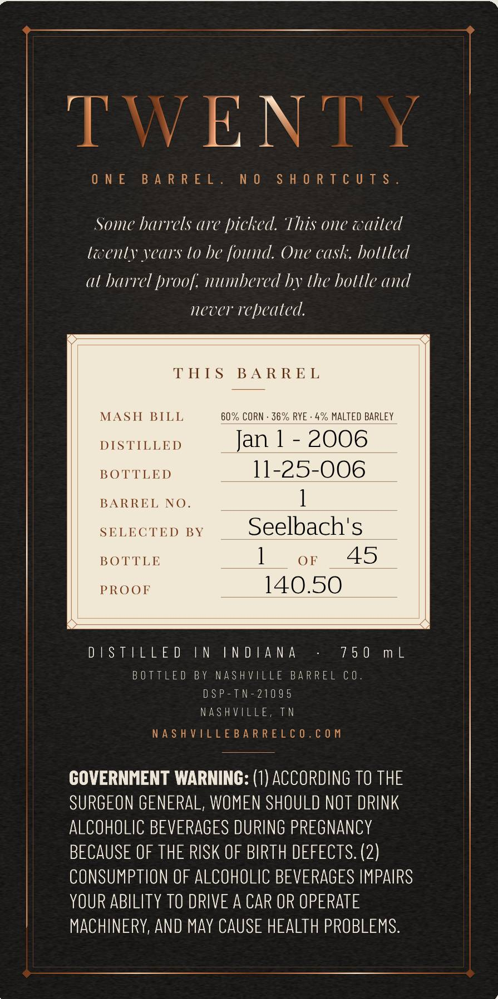
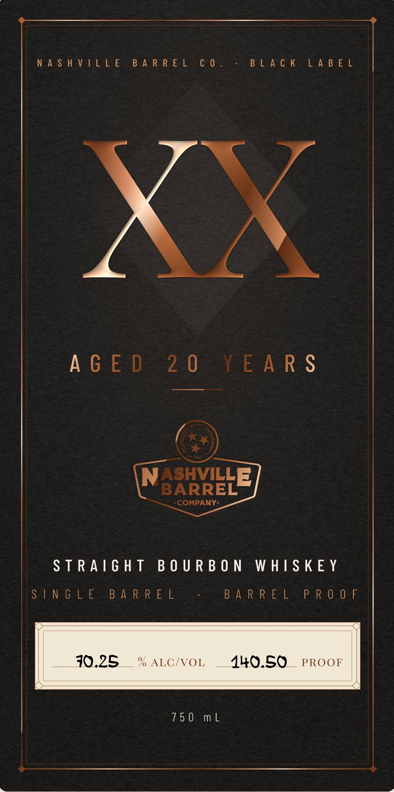

# TTB COLA Label Images - TTBID 26308001000729

**Brand Name:** NASHVILLE BARREL COMPANY

**Issue Date:** 11/09/2026

**Origin Code:** 43

**Product Class/Type:** 101

**Source:** [TTB Public COLA Registry](https://ttbonline.gov/colasonline/viewColaDetails.do?action=publicFormDisplay&ttbid=26308001000729)

## Label Images

### Back Label

### Front Label

## Extracted Label Text

*Text extracted via OCR - may contain errors*

### Back Label

eS ee Se ee a eee ee Se, ee
See Se ae aero
Wo Ne LY
ONE BARREL. NO SHORTCUTS.
Some barrels are picked. ‘This one waited
lewenly years lo he found. One cask, holtled
al barrel proof. numbered by the bottle and
never repeated.
THIS BARREL
MASH BILL 60% CORN - 36% RYE - 4% MALTED BARLEY
DISTILLED Jan | - 2006
BOTTLED 11-25-006
BARREL NO. ]
SELECTED BY Seelbach's
BOTTLE ] OF 45
PROOJI 140.50
DUES sels IS ESD = END IEN GD AGN Asse = fob Okeemmel:
| BOTTLED BY NASHVILLE BARREL CO
DSP-TN-21095
NASHVILLE, TN
NASHVILLEBARRELCO.COM
GOVERNMENT WARNING: (1) ACCORDING TO THE
SURGEON GENERAL, WOMEN SHOULD NOT DRINK
ALCOHOLIC BEVERAGES DURING PREGNANCY
BECAUSE OF THE RISK OF BIRTH DEFECTS. (2)
CONSUMPTION OF ALCOHOLIC BEVERAGES IMPAIRS
YOUR ABILITY TO DRIVE A CAR OR OPERATE
MACHINERY, AND MAY CAUSE HEALTH PROBLEMS.

### Front Label

XN

aX

AGED

20

EARS

ee

STRAIGHT BOURBON WHISKEY

Sal SNEGzlce

BARREL

BARREL

Dene Oe Jel:

70.25

ALC/VOL

440.50

PROOE

750 mL
