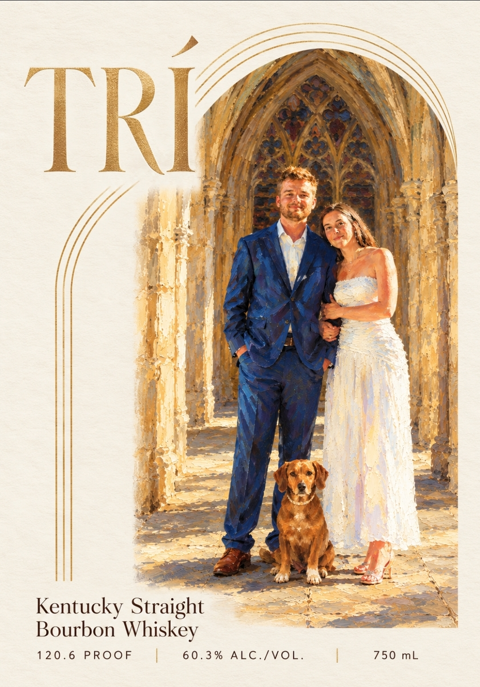
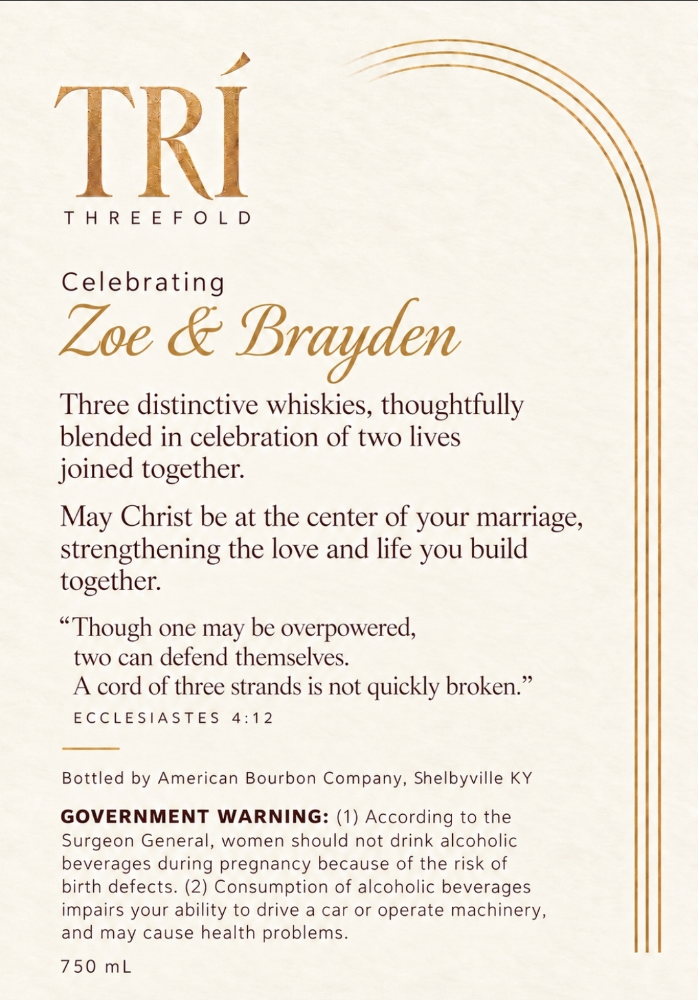

# TTB COLA Label Images - TTBID 26308001000736

**Brand Name:** TRI'

**Issue Date:** 11/09/2026

**Origin Code:** 22

**Product Class/Type:** 101

**Source:** [TTB Public COLA Registry](https://ttbonline.gov/colasonline/viewColaDetails.do?action=publicFormDisplay&ttbid=26308001000736)

## Label Images

### Label 1

### Label 2

## Extracted Label Text

*Text extracted via OCR - may contain errors*

### Label 1

TRI
Kentucky Straight
Bourbon Whiskey
120 .6
PROOF
6 0 . 3 %
ALC./VOL.
750 mL

### Label 2

TRI

THREEFOLD

Celebrating

Loe & Brayden

Three distinctive whiskies, thoughtfully

blended in celebration of two lives

joined together.

May Christ be at the center of your marriage,

strengthening the love and life you build

together.

“Though one may be overpowered,

two can defend themselves.

A cord of three strands is not quickly broken.”

ECCLESVAST 2S) 4)562

Bottled by American Bourbon Company, Shelbyville KY

GOVERNMENT WARNING: (1) According to the

Surgeon General, women should not drink alcoholic

beverages during pregnancy because of the risk of

birth defects. (2) Consumption of alcoholic beverages

impairs your ability to drive a car or operate machinery,

and may cause health problems.

750 mL
