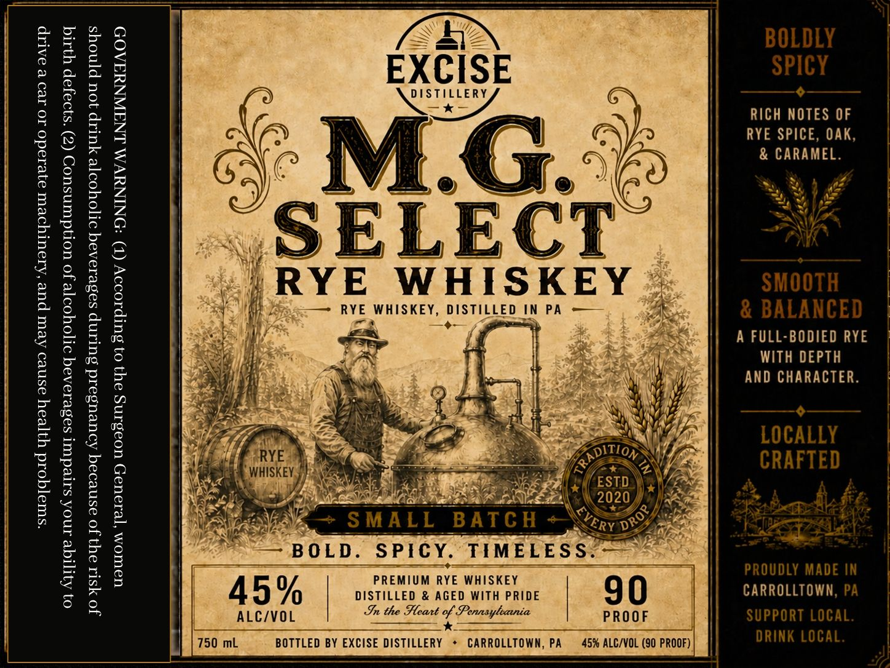

# TTB COLA Label Images - TTBID 26308001000780

**Brand Name:** M.G. SELECT RYE WHISKEY

**Issue Date:** 11/12/2026

**Origin Code:** 39

**Product Class/Type:** 142

**Source:** [TTB Public COLA Registry](https://ttbonline.gov/colasonline/viewColaDetails.do?action=publicFormDisplay&ttbid=26308001000780)

## Label Images

### Label 1

## Extracted Label Text

*Text extracted via OCR - may contain errors*

**Detected Proof:** 90

### Label 1

RICH NOTES OF
RYE SPICE, OAK,
& CARAMEL.

A FULL-BODIED RYE
WITH DEPTH
AND CHARACTER.

CARROLLTOWN,

45% ALC/VOL (90 PROOF) |

STILLERY

NE

In the Peart of Pennsyleania
= xe

PREMIUM RYE WHISKEY
DISTILLED & AGED WITH PRIDE

|

BOTTLED BY EXCISE DISTILLERY * CARROLLTOWN, PA

45%
ALC/VOL

750 mL

GOVERNMENT WARNING: (1) According to the Surgeon General, women
should not drink alcoholic beverages during pregnancy because of the risk of
birth defects. (2) Consumption of alcoholic beverages impairs your ability to
drive a car or operate machinery, and may cause health problems.
