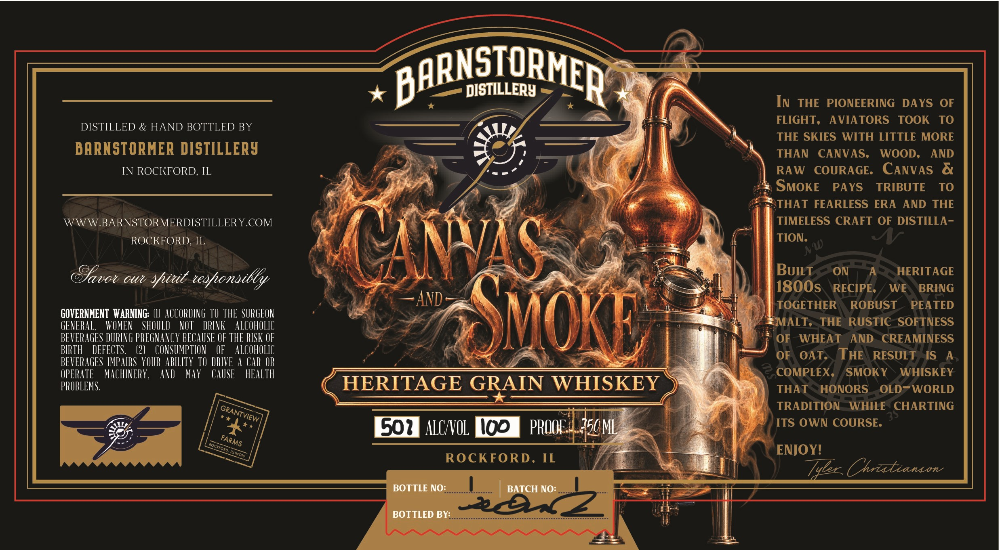

# TTB COLA Label Images - TTBID 26309001000003

**Brand Name:** CANVAS AND SMOKE

**Issue Date:** 11/10/2026

**Origin Code:** 04

**Product Class/Type:** 140

**Source:** [TTB Public COLA Registry](https://ttbonline.gov/colasonline/viewColaDetails.do?action=publicFormDisplay&ttbid=26309001000003)

## Label Images

### Label 1

## Extracted Label Text

*Text extracted via OCR - may contain errors*

### Label 1

BARNSIORMER
DISTILLERY
In
THE
PIONEERING
DAYS
OF
FLIGHT,
AVIATORS
TOOK
TO
DISTILLED & HAND BOTTLED BY
THE SKIES WITH LITTLE MORE
BARNSTORMER DISTILLERY
THAN
CANVAS;
WOOD;
AND
IN ROCKFORD, IL
RAW
COURAGE:  CANVAS
X
SMOKE
PAYS
TRIBUTE
TO
THAT FEARLESS ERA
AND THE
WWWBARNSTORMERDISTILLERY COM
TIMELESS CRAFT OF DISTILLA -
ROCKFORD, IL
TION:
Oavot
CANNAS
BUILT
ON
A
HERITAGE
OUi
teshonsilly
1800s
RECIPE,
WE
BRING
And
TOGETHER
ROBUST
PEATED
GOVERNMENT  WARNING: (L}   ACCORDING TO THE SURGEON
GENERAL,
IVOMEN
SHOULD
NOT
DRINK
ALCOHOLIC
Smoke
'MALT,
THE
RUSTIC SOFTNESS
BEVERAGES DURING PREGNANCY BECAUSE OF THE RISK OF
OF
WHEAT
AND
CREAMINESS
BIRTHL
DEFECTS:
(21
CONSUMPTION
OF
ALCOHLOLIC
OF
OAT
THE
RESULT
IS
A
BEVERAGES IMPAIRS YOURABLITY TO DRIVE
Car OR
OPERATE
MACHINERY ,
AnD
May
CAUSE
HEALTH
COMPLEX,
SMOKY
WHISKEY
PROBLEMS
HERITAGE GRAIN WHISKEY
THAT
HONORS
OLD-WORLD
TRADITION
WHILE  CHARTING
39
502
ALCNOL
IOD
PROOF
J50ML
ITS OWN COURSE:
ENJOY!
ROCKFORD, IL
Zyez_Chrattanson
BOTTLE NO:
BATCH NO:
BOTTLED BY:
sitt
GRANTVIEW
FARMS
Rocktord,
IuNols
