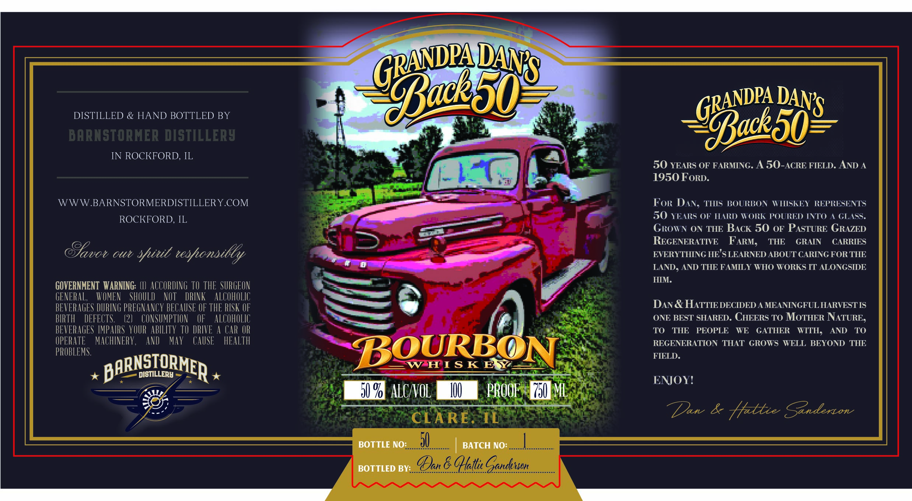

# TTB COLA Label Images - TTBID 26309001000004

**Brand Name:** GRANDPA DAN'S BACK 50

**Issue Date:** 11/13/2026

**Origin Code:** 04

**Product Class/Type:** 141

**Source:** [TTB Public COLA Registry](https://ttbonline.gov/colasonline/viewColaDetails.do?action=publicFormDisplay&ttbid=26309001000004)

## Label Images

### Label 1

## Extracted Label Text

*Text extracted via OCR - may contain errors*

**Detected Proof:** 100
**Detected Age:** 50 Years

### Label 1

DISTILLED
HAND BOTTLED BY
Cgubu
9gan54
BARNSTORNER DISTILLERY
IN ROCKFORD, IL
50 YEARS OF FARMING. A 50-ACRE FIELD. AND A
1950 FoRD.
WWWBARNSTORMERDISTILLERY COM
FoR DAV, THS BOURBON WIISKEY REPRESENTS
ROCKFORD, IL
50 WEARS OF HARD WORK POURED INTO
GLASS.
GROWN ON
THE BACK 50 0F' PASTURE GRAZED
REGENERATIVE
FARM,
THE
GRAIN
CARRIES
OUt
teshonsilly
EVERYTHING HE'S LEARNED ABOUT CARING FOR THE
LAND, AND THE FAMILY WHO WORKS IT ALONGSIDE
IM:
GOVERNMENT   WARNING: (L}   ACCORDING TO THE SURGEON
GENERAL,
IVOMEN
SHOULD
NOT
DRINK
ALCOHOLIC
BEVERAGES DURING PREGNANCY BECAUSE OF THE RISK OF
DAN & HATTIE DECIDED A MEANINGFUL HARVESTIS
BIRTHT
DEFECTS:
[21
CONSUMPTION
OF
ALCOHOLIC
ONE BEST SHARED . CHEERS TO MOTHER NATURE;
BEVERAGES IMPAIRS YOURABILITY TO DRIVE A CAr OR
TO
TIE
PEOPLE
WE
GATHER
WITI,
AND
TO
OPERATE
MACHINERY ,
AnD
MAy
CAUSE
HEALTH
REGENERATTON
THAT GROWS
WELL BEYOND THE
PROBLEMS:
BOURBON
FIELD.
BARNSIORMER
DISTILLERY
W HI S K EY
ENJOYI
50 % ALCNOL
I0
PROOF
750] ML:
CLARE
Da & Hfatlie Szlervon
BOTTLE NO:
50
BATCH NO:
BOTTLED BY:
Dan -
Hattic Gandcison_
DANS
DANS
Eavou
suitt
