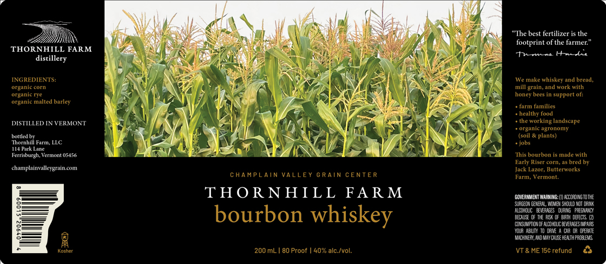

# TTB COLA Label Images - TTBID 26309001000066

**Brand Name:** THORNHILL FARM

**Issue Date:** 11/12/2026

**Origin Code:** 46

**Product Class/Type:** 141

**Source:** [TTB Public COLA Registry](https://ttbonline.gov/colasonline/viewColaDetails.do?action=publicFormDisplay&ttbid=26309001000066)

## Label Images

### Label 1

## Extracted Label Text

*Text extracted via OCR - may contain errors*

**Detected Proof:** 80

### Label 1

"The best fertilizer is the
footprint of the farmer;
THORNHILL FARM
HiL
disrillery
INGREDIENTS:
We make whiskey and bread,
organic
COCI
Inill grain, and work with
organicrye
honey bees in support of:
malted barley
farm families
healthy food
DISTILLED INVERMONT
the working andscape
organic agronomy
bottled by
(soil & plants)
Thornhili Farm, LLC
JTTIkLant
Ferrisburgh, Vermont 05456
This bourbon
made with
Early Riser cOTi,
bred by
champlainvalleyerain com
Jack Lazor; Kutterworks
chAMPLATN VALLEY GRaTN
CENTER
Fanm
Vermont.
THO RN HILL
FARM
COVERhMENT WARYIHG:
ROcofL NG ToThe
g
SURGEOV CEHDUL KQVEX ShCLld NdT dANK
alCuhQU
EVEFAGES   @URIG  REghaCy
bourbon whiskey
BECAUS
Il AEI
BHRTH DOTCtS (
DonsuMpicncFaldiuc eeicagesipies

YOUA  ABIUN
Wame
UerTE
WchINeRL Avd WaYcUCe henlth pageLeUS
Rosner
200 mL
80 Proof
40% alc Ivol.
VT & ME 15c refund
Otranic
obs
