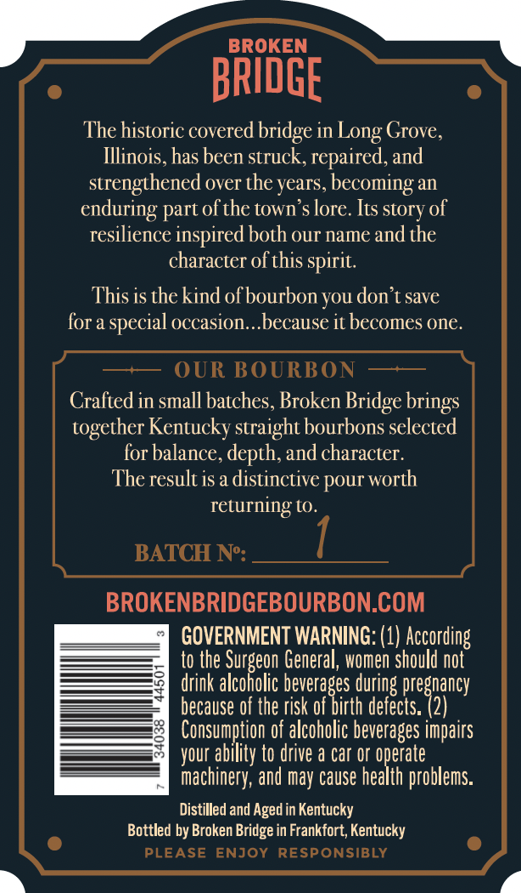
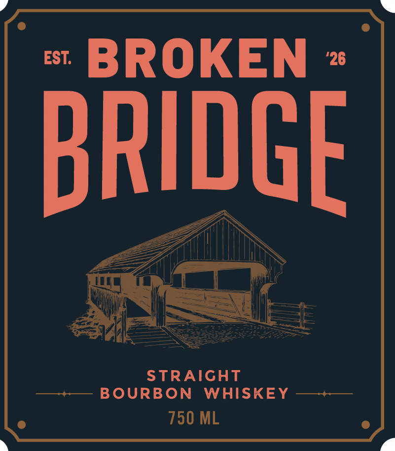
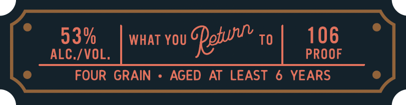

# TTB COLA Label Images - TTBID 26309001000097

**Brand Name:** BROKEN BRIDGE

**Issue Date:** 11/09/2026

**Origin Code:** 22

**Product Class/Type:** 101

**Source:** [TTB Public COLA Registry](https://ttbonline.gov/colasonline/viewColaDetails.do?action=publicFormDisplay&ttbid=26309001000097)

## Label Images

### Back Label

### Label 1

### Label 2

## Extracted Label Text

*Text extracted via OCR - may contain errors*

**Detected Proof:** 106
**Detected Age:** 6 Years

### Back Label

BROKEN
BRIDGE
The historic covered bridge in
Grove,
Illinois, has been struck, repaired, and
strengthened over the years, becoming an
enduring part ofthe town $ lore. Its story of
resilience inspired both our name and the
character ofthis spirit.
This is thekind ofbourbon you don t save
for a
occasion._because it becomes one.
OUR BOURBON
Cralied in small batches, Broken Bridge
together Kentucky straight bourbons selected
for balance, depth,and character,
The result is a distinctive pour worth
returning tO.
BATCH No:
BROKENBRIDGEBOURBON.COM
GOVERNMENT WARNING: (1) According
to the
General, women should not
drink
Fakonobe 5
beverages during L
cb5e Zaney
because of the risk of birth defects.
8
Consumption of alcoholic beverages impairs
your ability to drive a car Or operate
machinery, and may cause health problems:
Distilled and Aged in Kentucky
Bottled by Broken Bridge in Frankfort; Kentucky
PLEASE
ENJOY
RESPONSIBLY
Long
special =
brings

### Label 1

EST;
BROKEN
26
BRIDGE
STRAIGHT
BOURBON
WHISKEY
750 ML

### Label 2

53%
WHAT YOU
Qot _
TO
106
ALC./VOL.
PROOF
FOUR GRAIN
AGED
AT LEAST
6
YEARS
