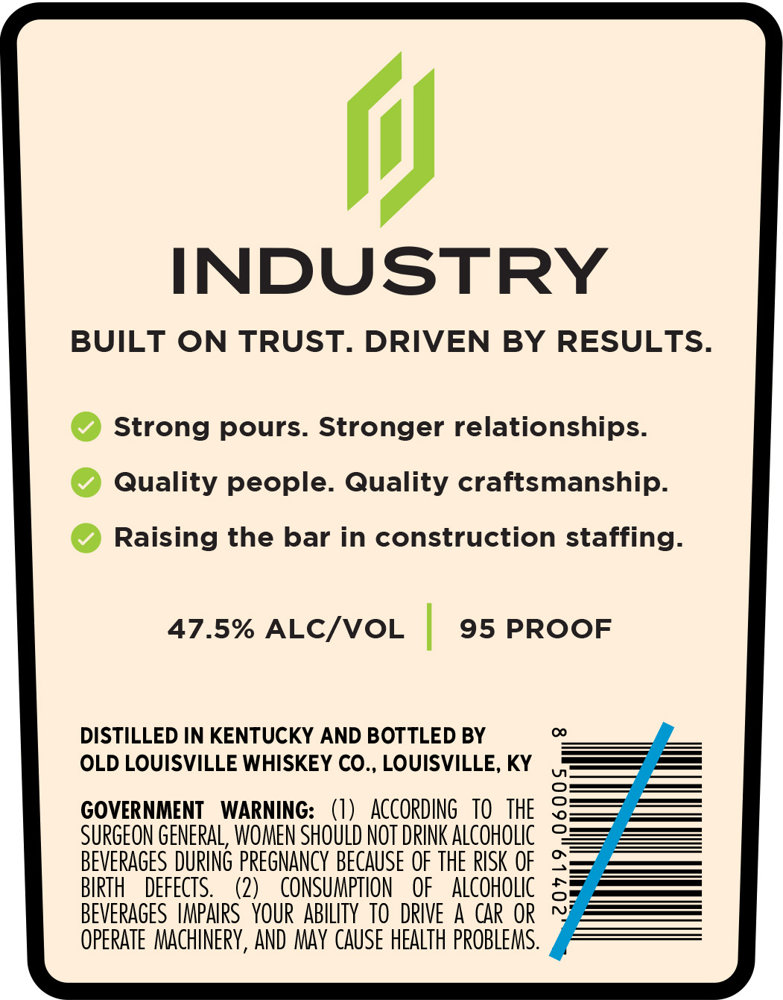
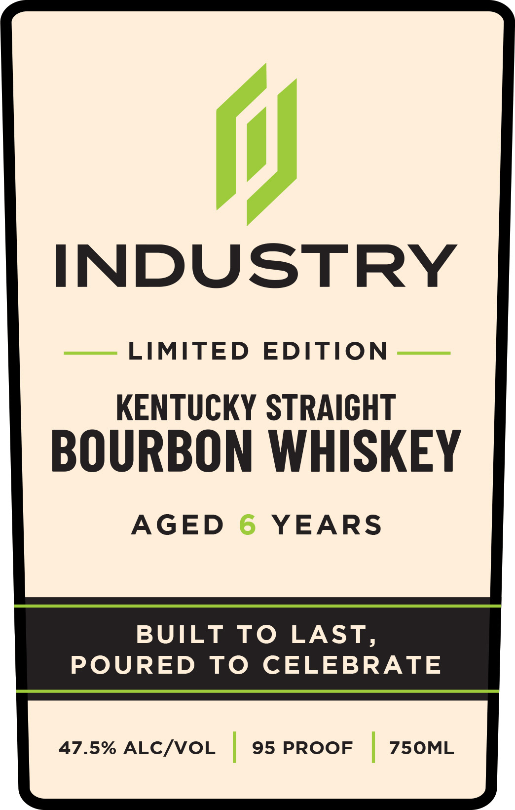

# TTB COLA Label Images - TTBID 26309001000118

**Brand Name:** INDUSTRY

**Issue Date:** 11/09/2026

**Origin Code:** 22

**Product Class/Type:** 101

**Source:** [TTB Public COLA Registry](https://ttbonline.gov/colasonline/viewColaDetails.do?action=publicFormDisplay&ttbid=26309001000118)

## Label Images

### Back Label

### Front Label

## Extracted Label Text

*Text extracted via OCR - may contain errors*

**Detected Proof:** 95
**Detected Age:** 6 Years

### Back Label

i}

INDUSTRY

BUILT ON TRUST. DRIVEN BY RESULTS.

© Strong pours. Stronger relationships.

© Quality people. Quality craftsmanship.

© Raising the bar in construction staffing.

47.5% ALC/VOL

95 PROOF

DISTILLED IN KENTUCKY AND BOTTLED BY

OLD LOUISVILLE WHISKEY CO., LOUISVILLE, KY

GOVERNMENT WARNING: (1) ACCORDING 10 THE

SURGEON GENERAL, WOMEN SHOULD NOT DRINK ALCOHOLIC

BEVERAGES DURING PREGNANCY BECAUSE OF THE RISK OF

BIRTH DEFECTS.

CONSUMPTION OF ALCOHOLIC

BEVERAGES IMPAIRS YOUR ABILITY TO DRIVE A CAR OR

(2)

OPERATE MACHINERY, AND MAY CAUSE HEALTH PROBLEMS

### Front Label

INDUSTRY
LIMITED
EDITION
KENTUCKY STRAIGHT
BOURBON WHISKEY
AGED
6
YEARS
BUILT
To LAST,
POURED
To
CELEBRATE
47.5% ALCIVOL
95 PROOF
75OML
