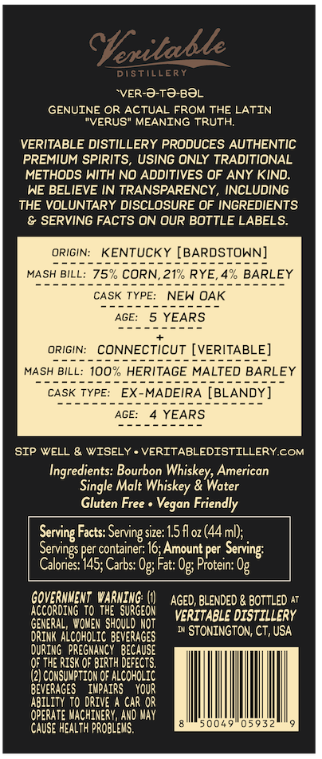
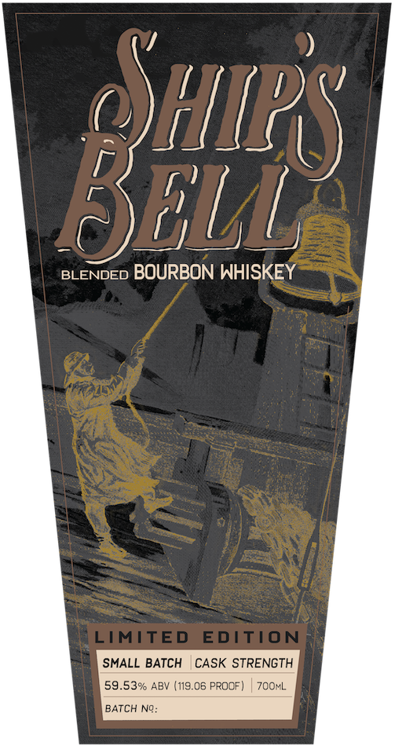

# TTB COLA Label Images - TTBID 26309001000205

**Brand Name:** SHIP'S BELL

**Fanciful Name:** SMALL BATCH CASK STRENGTH

**Issue Date:** 11/18/2026

**Origin Code:** 14

**Product Class/Type:** 131

**Source:** [TTB Public COLA Registry](https://ttbonline.gov/colasonline/viewColaDetails.do?action=publicFormDisplay&ttbid=26309001000205)

## Label Images

### Back Label

### Front Label

## Extracted Label Text

*Text extracted via OCR - may contain errors*

**Detected Age:** 5 Years

### Back Label

utable
Distillery
~'VER-a-ta-BOL
GENUINE OR ACTUAL FROM THE LATIN
"VERUS" MEANING TRUTH:
VERITABLE DISTILLERY PRODUCES AUTHENTIC
PREMIUM SPIRITS, USING ONLY TRADITIONAL
METHODS WITH NO ADDITIVES OF ANY KIND:
WE BELIEVE IN TRANSPARENCY , INCLUDING
THE VOLUNTARY DISCLOSURE OF INGREDIENTS
€ SERVING FACTS ON OUR BOTTLE LABELS:
ORIGIN:
KENTUCKY [BARDSTOWN]
MASH BILL: 75% CORN, 21% RYE, 4% BARLEY
CASK
TYPE:
NEW OAK
AGE:
5 YEARS
ORIGIN:
CONNECTICUT [VERITABLE]
MASH BILL: 100% HERITAGE MALTED BARLEY
CASK TYPE:
EX-MADEIRA [BLANDY]
AGE:
YEARS
SIP WELL & WISELY
VERITABLEDISTILLERYCOM
Ingredients: Bourbon Whiskey; American
Single Malt Whiskey & Water
Gluten Free
Vegan Friendly
Serving Facts: Serving size: 1.5 floz (44 ml);
container: 16; Amount per
Calories:
[e5sontaine0g6F4rognFrotein:Qi
GOVERNMENT
TARVIRG
AGED; BLENDED & BOTTLED AT
ACCORdING TO
SURGEOH
VERITABLE DISTILLERY
GENERAL, WONEN  ShOULD NoT
dRink ALlcohoLic BEVERAGES
STONINGTON; CT, USA
during Preghanc
BECAUSE
OF THE RISK Of BIRTH DEFECTS
(2) CONSUMPTION OF ALCOHOLIC
BEVERAGES
IMpairs
YouR
AbILITy TO DRIVE A Car OR
OPERATE MACHINERY, ANd May
CAUSE HEALTH PROBLEMS.
Servings [
Serving:

### Front Label

851L
BLENDED BOURBON WHISKEY
LIMITED
EDITION
SMALL BATCH
CASK STRENGTH
59.53% ABV (119.06 PROCF)
70OvL
BATCH NQ:
hIPS
