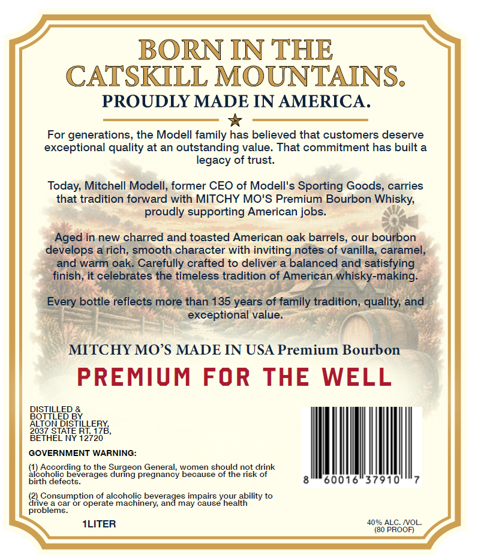
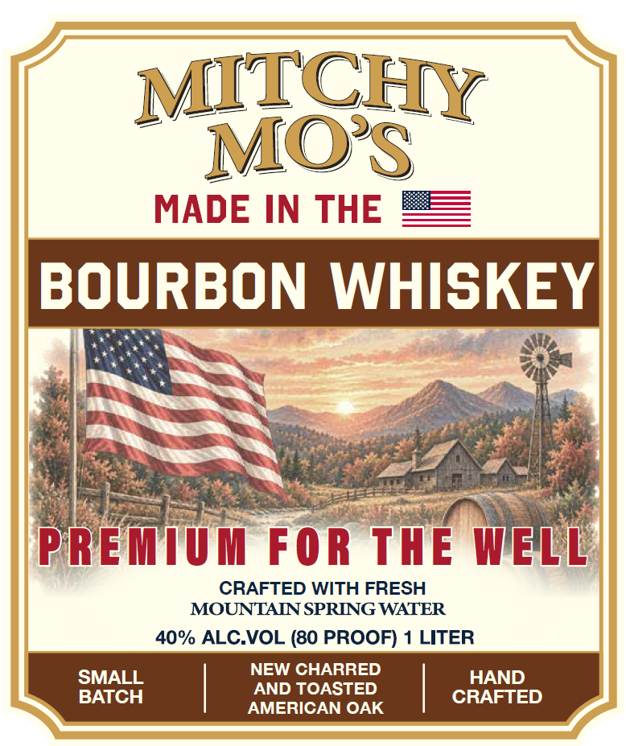
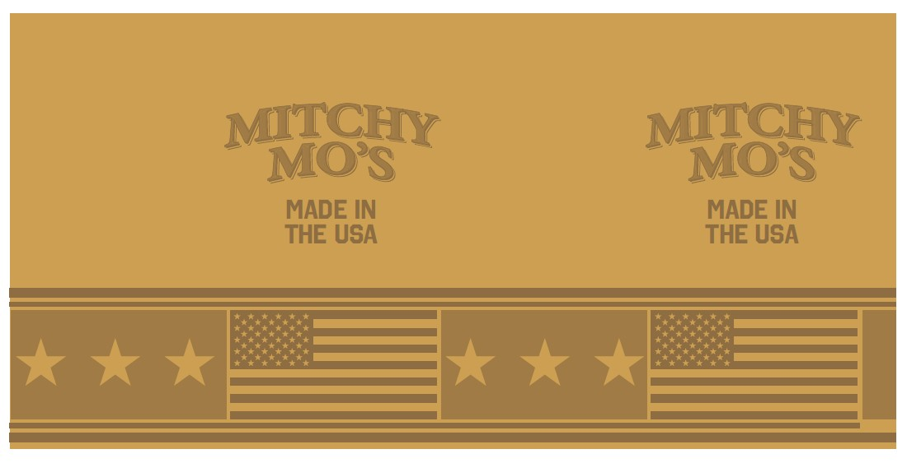

# TTB COLA Label Images - TTBID 26309001000223

**Brand Name:** MITCHY MO'S BOURBON WHISKEY

**Issue Date:** 11/12/2026

**Origin Code:** 02

**Product Class/Type:** 141

**Source:** [TTB Public COLA Registry](https://ttbonline.gov/colasonline/viewColaDetails.do?action=publicFormDisplay&ttbid=26309001000223)

## Label Images

### Back Label

### Front Label

### Label 3

## Extracted Label Text

*Text extracted via OCR - may contain errors*

**Detected Proof:** 80

### Back Label

BORN IN THE
CATSKILL MOUNTAINS:
PROUDLY MADE IN AMERICA.
For generations, the Modell family has believed that customers deserve
exceptional quality at an outstanding value: That commitment has built a
legacy of trust
Mitchell Modell; former CEO of Modell's Sporting Goods; carries
that tradition forward with MITCHY MO'S Premium Bourbon Whisky;
proudly supporting American jobs:
Aged in new charred and toasted American oak barrels; our bourbon
develops a rich; smooth character with inviting notes of vanilla; caramel,
and warm oak. Carefully crafted to deliver a balanced and satisfying
finish; it celebrates the timeless tradition of American whisky-making:
Every bottle reflects more than 135 years of family tradition; quality; and
exceptional value.
MITCHY MO S MADE IN USA Premium Bourbon
PREMIUM
FOR THE
WELL
B8TEB3
BEPEE44430
GOVERNMENT WARNING:
According to the Surgeon General, women should not drink
Icoholig beverages cluring pregnancy because of the risk of
bicth" Qefeces
60016"37910'
Consumption of alcoholic
Jbeyeand
es impairs your
clrive
car Or
operate machinery;
may cause
problems
1LITER
4090 ALC: NOL;
(80 PROOF)
Today;
vRealthility -

### Front Label

MITCHY
MOS
MADE IN THE
BOURBON WHISKEY
PREMTOM FOR THE WELL
CRAFTED WITH FRESH
MOUNTAIN SPRING WATER
40% ALC.VOL (80 PROOF)
LiTeR
SMALL
NEW CHARRED
HAND
AND TOASTED
BATCH
CRAFTED
AMERICAN OAK

### Label 3

MTCHY
MITCHY
MOS
MOS
MADE IN
MADE IN
THE USA
THE USA
