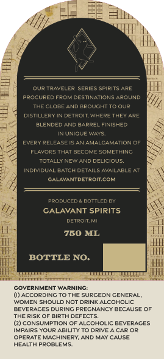
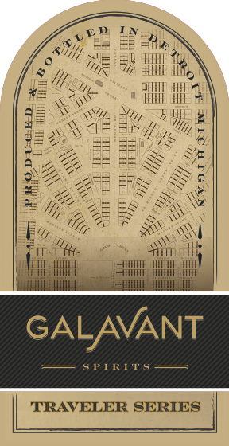

# TTB COLA Label Images - TTBID 26309001000271

**Brand Name:** TRAVELER SERIES

**Issue Date:** 11/10/2026

**Origin Code:** 06

**Product Class/Type:** 121

**Source:** [TTB Public COLA Registry](https://ttbonline.gov/colasonline/viewColaDetails.do?action=publicFormDisplay&ttbid=26309001000271)

## Label Images

### Back Label

### Front Label

## Extracted Label Text

*Text extracted via OCR - may contain errors*

### Back Label

Our TRAVELER Series Spirits ARE
PPOLURED FROM
EElnenlalmseaeab
THE CLOEE AND @ROUCHTTC
DISTILLERY
DeTRciT " HERE THEYARE
BLENCEDANC
3AppELFINiSHED
UNIQUP
EYfPY
RFLFASE
AMALCAMATION DF
FLAYCRS ThAT DECOME SCKETHING
TONal Neend DELclaus
NCIIDUA
PaTcKDETAIlsAvAILABLE A1
CALAVANTDETROiTCOM
PPCDUceD
POTTLEDBY
CALAVANT SPIRITS
DeTRoITKi
750 ML
BOTTLE NO:
COVERNMENT WARNINC:
(0) ACCORDING TO THE SURCEON CENERAL
WOMEN SHOULD NOT DRINK ALCOHOLIC
BEVERACES
DURING
PRECNANCY BECAUSE OF
THE RISK OF BIRTH
FFECTS
(2) CONSUMPTION OF ALCOHOLIC BEVERACES
IMPAIRS YOUR ABILITY TO DRIVE
CAR OR
OPERATE MACHINERY AND MAY CAUSE
HEALTH PPOBLEMS

### Front Label

yP Ly
iy ms Ee ate
RUE eee en
9 Re Sh ty
Qty UR Ue All Ay,
fee Piet het
Bey ITE AINE
Geb Se Nyy ou
ds BS Ie BE alg
Mas OO ibs Baek - Se
Ee oe ce SK NS
s pe
Ev. sae Saal
Virsa Nin i
TRAVELER SERIES
