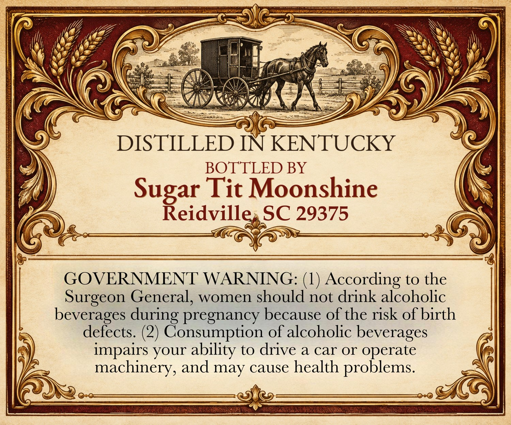
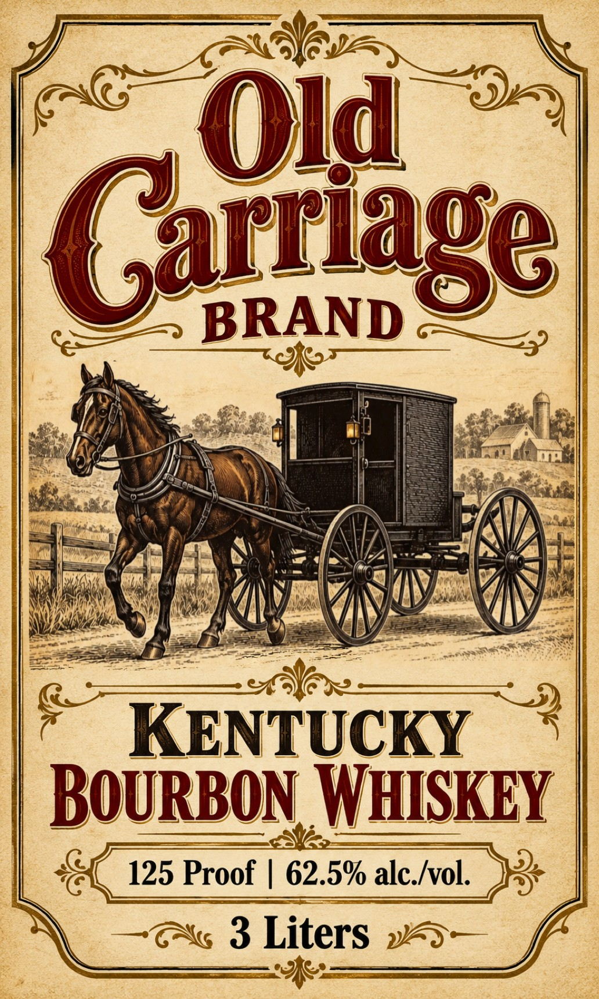

# TTB COLA Label Images - TTBID 26309001000295

**Brand Name:** OLD CARRIAGE

**Issue Date:** 11/10/2026

**Origin Code:** 41

**Product Class/Type:** 141

**Source:** [TTB Public COLA Registry](https://ttbonline.gov/colasonline/viewColaDetails.do?action=publicFormDisplay&ttbid=26309001000295)

## Label Images

### Back Label

### Front Label

## Extracted Label Text

*Text extracted via OCR - may contain errors*

**Detected Proof:** 125

### Back Label

DISTILLED IN KENTUCKY
BOTTLED BY
Tit Moonshine
Sugeidvite
SC 29375
GOVERNMENT WARNING: (1) According to the
Surgeon General, women should not drink alcoholic
beverages during pregnancy because of the risk of birth
defects: (2) Consumption of alcoholic beverages
impairs your ability to drive a car Or operate
machinery, and may cause health problems.

### Front Label

Old
Gartnge]
BRAND
c
752
KENTUCKY
BOuRBOn WHISKEY
125 Proof
62.5% alc_Ivol.
3 Liters
